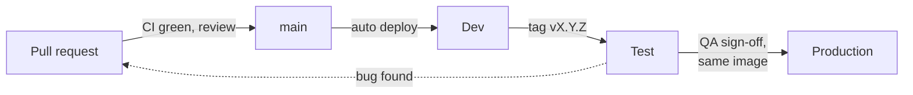

# Orbit: environments and deployment

How Orbit runs in each environment, and how to deploy to it. To run it on your own machine, see [README.md](README.md). For what each setting means, see [TECH-README.md §7](TECH-README.md#7-configuration-reference).

**Contents**
1. [The four environments](#1-the-four-environments)
2. [What exists today and what's still needed](#2-what-exists-today-and-whats-still-needed)
3. [Release flow](#3-release-flow)
4. [Building the artifacts](#4-building-the-artifacts)
5. [Local](#5-local)
6. [Dev](#6-dev)
7. [Test](#7-test)
8. [Production](#8-production)
9. [Database migrations](#9-database-migrations)
10. [Rollback](#10-rollback)

---

## 1. The four environments

| | **Local** | **Dev** | **Test** | **Production** |
|---|---|---|---|---|
| Purpose | One developer's machine | Shared integration of the latest `main` | Release candidates, QA and two-device testing | Real members |
| Who uses it | You | The team | The team and testers | Members and moderators |
| Deployed | By hand (`bootTestRun`) | Automatically on every merge to `main` | On a release tag | By an approved promotion of the tested build |
| Data | Thrown away on stop; fictional seed members | Disposable; may be reset | Copy-like but fictional; never real member data | Real; backed up |
| Sign-in | Local Keycloak with fixture users | Shared OIDC realm, test users only | Separate OIDC realm, test users only | Production OIDC: Apple, Google, phone |
| Mobile config | `config/dev.json` | `config/dev.json` with the dev URLs | `config/staging.json` | `config/prod.json` |
| Mobile delivery | `flutter run` | Internal builds | TestFlight and Play internal testing | App Store and Google Play |
| Payments | None | None | Store sandbox | Real |

Each deployed environment has its **own** database, Redis, bucket, OIDC realm and secrets. Nothing is ever shared between them.

---

## 2. What exists today and what's still needed

Orbit is pre-launch. The application is ready to be configured for any environment, but the infrastructure around it hasn't been built yet.

| Piece | Status |
|---|---|
| Backend reads all settings from the environment and fails fast if one is missing | ✅ Ready |
| Health probes for liveness and readiness | ✅ Ready |
| Database migrations (Flyway) | ✅ Ready |
| CI: backend and mobile build and test on every push and PR | ✅ Ready (`.github/workflows/ci.yml`) |
| CI for the moderation console | ❌ Needed: add a job running lint, typecheck, test and build |
| Container image | ⚠️ Possible with `./gradlew bootBuildImage`; no registry or pipeline yet |
| Infrastructure as code (cluster, database, Redis, bucket, CDN) | ❌ Needed |
| CD pipeline (build, push image, deploy, run migrations) | ❌ Needed |
| Production OIDC set-up (Apple, Google, phone) | ❌ Needed |
| Push notifications | ❌ Needed: today `LoggingPushSender` only writes a log line. Add FCM and APNs. |
| Image safety scanning | ❌ Needed before launch: today `AllowAllMediaScanner` accepts everything. Known illegal content must be matched on upload. |
| Mobile signing and store listings | ❌ Needed |
| Orbit+ payments | ❌ Needed: today Subscribe only flips a flag |
| Cleanup of stuck non-status events | ⏳ Built on branch `feat/event-publication-retention`, not merged yet |

The target design is in [design-doc §11](docs/design/design-doc.md#11-deployment): Kubernetes with an `orbit-api` deployment, managed PostgreSQL with PostGIS, managed Redis, versioned object storage behind a CDN, a secret manager and an observability stack.

---

## 3. Release flow



- **Build once, promote the same artifacts.** The image and mobile build tested in Test are exactly what reaches Production. Only the configuration differs.
- **CI must pass before merging.** CI runs `./gradlew build` for the backend, and `dart format`, `flutter analyze` and `flutter test` for the app.
- **Mobile releases go through the stores' review.** Server changes must stay compatible with the mobile versions members still have installed.

---

## 4. Building the artifacts

### Backend container image

Spring Boot builds an image without a Dockerfile:

```bash
cd backend && ./gradlew bootBuildImage --imageName=<registry>/orbit-api:<version>
```

Run it with the environment's settings (§6 to §8). The container listens on port 8080.

| Endpoint | Use |
|---|---|
| `/actuator/health/liveness` | Liveness probe: restart the container if it fails |
| `/actuator/health/readiness` | Readiness probe: send traffic only when it passes |

Shutdown is graceful, with 20 seconds to finish in-flight requests, so give the platform a termination grace period of at least 30 seconds.

### Moderation console

Settings are baked in when the console is built, so build once per environment:

```bash
cd admin && npm ci && VITE_OIDC_AUTHORITY=<issuer> VITE_OIDC_CLIENT_ID=orbit-admin npm run build
```

Serve `admin/dist/` as static files from the **same origin** as the API, with `/api` routed to the API. That way the console needs no CORS rules. Route unknown paths to `index.html`, because the console handles its own routes.

### Mobile apps

Fill in the environment's file first (`config/staging.json` or `config/prod.json`; see TECH-README §5.3 for the keys). Then build:

```bash
cd mobile && flutter build ipa --dart-define-from-file=config/prod.json
```

```bash
cd mobile && flutter build appbundle --dart-define-from-file=config/prod.json
```

Each file needs `ORBIT_FLAVOR`, an `https://` `ORBIT_API_BASE_URL` and `ORBIT_OIDC_ISSUER`. Signing keys and certificates stay in the CI secret store, never in the repo.

---

## 5. Local

Covered in full in the [README](README.md#1-quick-start-two-phones-chatting). In short, `./gradlew bootTestRun` starts the API on 8080 with throwaway containers for PostGIS, Redis, S3Mock and Keycloak (8180), plus fictional seed members, reports and chat replies.

The seed data, the fixture users and the password grant used by `scripts/dev-token.sh` exist **only** on the test classpath. They can never reach a deployed environment.

---

## 6. Dev

A shared environment that always runs the latest `main`.

| Setting | Value |
|---|---|
| API | One small instance (scheduling on) |
| Database | Small managed PostgreSQL 17 with PostGIS; resettable |
| Redis | Small managed Redis |
| Storage | Bucket `orbit-dev-media`, private, no CDN needed |
| OIDC | Realm `orbit-dev`, clients `orbit-mobile` and `orbit-admin`, realm role `moderator`, test users only |

Environment for the API (values from the secret manager):

```
SPRING_DATASOURCE_URL=jdbc:postgresql://<dev-db-host>:5432/orbit
SPRING_DATASOURCE_USERNAME=<from secret manager>
SPRING_DATASOURCE_PASSWORD=<from secret manager>
SPRING_DATA_REDIS_URL=rediss://<dev-redis-host>:6379
SPRING_SECURITY_OAUTH2_RESOURCESERVER_JWT_ISSUERURI=https://<dev-idp>/realms/orbit-dev
SPRING_SECURITY_OAUTH2_RESOURCESERVER_JWT_AUDIENCES=orbit-api
ORBIT_MEDIA_BUCKET=orbit-dev-media
ORBIT_MEDIA_REGION=<region>
```

To deploy (once the CD pipeline exists, it does this on every merge to `main`):
1. Build and push the image tagged with the commit SHA.
2. Roll out the new image. Flyway applies new migrations as the first instance starts (see §9).
3. Build the console with the dev issuer and publish it.
4. Point developers' phones at dev by putting the dev URLs into a copy of `config/dev.json`.

Test users for dev are created in the dev OIDC realm. Real people's details must never be used.

---

## 7. Test

The pre-production environment where release candidates are checked, including the two-phone walkthrough. It should match Production in shape (several API instances, CDN, a replica database), just smaller.

| Setting | Value |
|---|---|
| API | At least 2 instances, to catch problems that only show with several servers (jobs, WebSocket fan-out) |
| Database | Managed PostgreSQL with a read replica and point-in-time recovery |
| Storage | Bucket `orbit-test-media` behind a CDN |
| OIDC | Realm `orbit-test`, test users only, and production-like providers in sandbox mode |
| Mobile | `config/staging.json`, distributed through TestFlight and Play internal testing |
| Payments | App Store and Play sandbox |

To deploy:
1. Tag the release (`vX.Y.Z`) on `main`. The pipeline deploys that tag's image.
2. Migrations run. Check they're backward compatible with the version still in Production (§9).
3. Upload the mobile builds made with `config/staging.json` to TestFlight and Play internal testing.
4. Run the release checklist. It covers:
   - Sign-in, onboarding and the grid.
   - Live chat between two devices, including read ticks.
   - The wave limit.
   - Posting, viewing and expiring a status.
   - Block and report.
   - Moderation actions in the console.
   - Light and dark mode.
   - A cold start on a mid-range Android phone.
5. Sign-off by QA promotes the same image and builds to Production.

---

## 8. Production

| Setting | Value |
|---|---|
| API | 2 to 20 instances with autoscaling, spread across zones |
| Database | Managed PostgreSQL 17 + PostGIS, primary plus replica, point-in-time recovery, encrypted at rest |
| Redis | Managed, highly available |
| Storage | Versioned, encrypted bucket `orbit-prod-media`, served through a CDN. The API's IAM role grants access, not static keys. |
| OIDC | Production identity provider with Sign in with Apple, Google and phone; short-lived access tokens with refresh rotation; **password grant disabled** |
| Secrets | Secret manager only; rotate on any exposure |
| Edge | TLS everywhere, a web application firewall, rate limits, and security headers (CSP, HSTS) |
| Observability | JSON logs, metrics, traces, alerts on error rate, latency and moderation queue age |

The production environment uses the same variables as Dev (§6) with production values. In addition:
- `ORBIT_CHAT_ALLOWEDORIGINS`: only if a browser client ever uses the WebSocket.
- Never set `ORBIT_MEDIA_ACCESSKEY` or `ORBIT_MEDIA_SECRETKEY`; use the IAM role.

**Must be done before the first production release** (from §2):
- Real push notifications.
- Image safety scanning.
- Orbit+ payments.
- Store signing.
- Merging event-publication cleanup.
- A data-protection impact assessment, because sexual orientation is special-category data under GDPR.

To deploy:
1. Approve the promotion of the build that passed Test. Change nothing else.
2. Apply migrations (§9), then roll out gradually, watching error rate and latency.
3. Release the mobile builds to the stores, ideally with a staged rollout.
4. Keep the previous image ready for rollback (§10).

---

## 9. Database migrations

- **When they run:** Flyway runs migrations when the API starts. With several instances, Flyway's lock makes sure only one applies them.
- **Recommended for Test and Production:** run them as a separate one-off job before the rollout, so a failing migration stops the release before any traffic moves.
- **Compatible changes:** every migration must work with both the old and the new app version running at once:
  1. **Expand:** add the new column, table or index.
  2. **Migrate:** deploy code that uses both the old and the new, and backfill.
  3. **Contract:** remove the old in a later release.
- **Never** edit or delete a migration that has run anywhere; add a new one.
- **Big tables:** create indexes on large tables in their own migration, and expect them to take time.

---

## 10. Rollback

| What went wrong | Do this |
|---|---|
| A bad API release | Roll back to the previous image. This is safe because migrations are always backward compatible (§9). |
| A bad migration | Don't roll the schema back by hand. Ship a new migration that fixes it forward. Use point-in-time recovery only for data loss. |
| A bad console release | Re-publish the previous `dist/` build. |
| A bad mobile release | Halt the staged rollout in the store, then fix forward. The server must keep working with the app versions members already have. |
| A leaked secret | Rotate it in the secret manager immediately and restart the instances that use it. |
