# Orbit (working title)

Orbit is a fast, battery-light, ad-free and privacy-first app for meeting people nearby, for iOS and Android. It is an original, clean-room design.

This README is for **running and using** the app. The other guides:

| Guide | Read it for |
|---|---|
| [TECH-README.md](TECH-README.md) | The tech stack, languages, architecture, modules, configuration, tests and coding rules |
| [DEPLOYMENT.md](DEPLOYMENT.md) | The local, dev, test and production environments, and how to deploy to each |
| [docs/design/design-doc.md](docs/design/design-doc.md) | The product and system design |
| [docs/adr/](docs/adr/) | Architecture decisions |

**Contents**
1. [Quick start: two phones chatting](#1-quick-start-two-phones-chatting)
2. [Test users and signing in](#2-test-users-and-signing-in)
3. [Finding your way around](#3-finding-your-way-around)
4. [Features](#4-features)
5. [The moderation console](#5-the-moderation-console)
6. [Other ways to run](#6-other-ways-to-run)
7. [Troubleshooting](#7-troubleshooting)
8. [Known issues](#8-known-issues)

---

## 1. Quick start: two phones chatting

The fastest way to see Orbit working is two iPhone simulators signed in as two different members, chatting with each other through a local server.

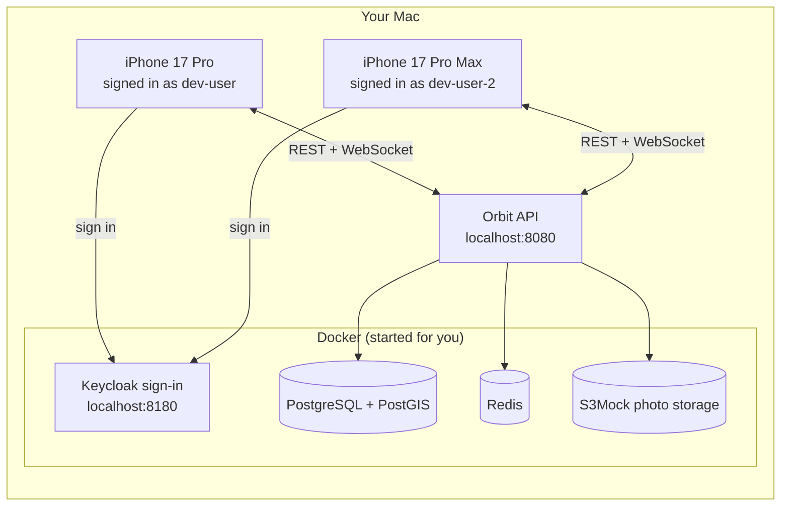

### 1.1 What you need

| Tool | Version | Check with |
|---|---|---|
| macOS with Xcode | Xcode 26 or later, with an iOS simulator runtime | `xcodebuild -version` |
| Docker Desktop | Running | `docker info` |
| JDK | 21 | `java -version` |
| Flutter | 3.41.5 | `flutter --version` |
| Node.js | 22 (only for the moderation console) | `node -v` |

### 1.2 Start the server

One command starts the API and everything it needs in Docker: the database, Redis, photo storage and the Keycloak sign-in server. It also adds 24 fictional members around San Francisco, so the grid isn't empty.

```bash
cd backend && ./gradlew bootTestRun
```

Wait for `Started OrbitApiApplication` in the output, then leave it running. Everything is thrown away when you stop it.

### 1.3 Boot two simulators

List the simulators you have, and pick two. Any two iPhone models work:

```bash
xcrun simctl list devices available | grep iPhone
```

Copy their IDs (the long values in brackets) into two variables. Use IDs, not names: two simulators can share a name, and booting by name may start the wrong one. Replace the values with your own IDs:

```bash
export PHONE_A=226EA64C-A8FD-4F27-B6FA-AE6E3803EE2C PHONE_B=6B6EBC17-9444-4A1D-95E3-8DDEEB0FC7BB
```

Boot both and open the Simulator window:

```bash
xcrun simctl boot $PHONE_A; xcrun simctl boot $PHONE_B; open -a Simulator
```

### 1.4 Put both phones near the seeded members

The fictional members live around San Francisco. Give both phones a location there:

```bash
for p in $PHONE_A $PHONE_B; do xcrun simctl location $p set 37.775,-122.419; done
```

When the app asks for your location during onboarding, tap **Allow while using**.

### 1.5 Run the app on both phones

Use two terminal windows, one per phone. Start the second only after the first shows `Flutter run key commands`, so the two Xcode builds don't collide.

```bash
cd mobile && flutter run -d $PHONE_A --dart-define-from-file=config/dev.json
```

```bash
cd mobile && flutter run -d $PHONE_B --dart-define-from-file=config/dev.json
```

`config/dev.json` points the app at the local server and the local Keycloak. In those terminals, press `r` to hot reload after a code change, `R` to restart, and `q` to quit.

### 1.6 Sign in and chat

1. On phone A, sign in as `dev-user` and finish onboarding ([section 2](#2-test-users-and-signing-in)). Call this member Robin.
2. On phone B, sign in as `dev-user-2` and finish onboarding. Call this member Sam.
3. On Robin's phone, pull down on the **Nearby** grid to refresh. Sam's tile appears at the top with a green online dot.
4. Tap Sam's tile, then **Message**, type something and send it. It appears on Sam's phone straight away. When Sam opens the chat, Robin's ticks turn red: read.

The seeded fictional members also answer messages after a few seconds, so you can try chat with one phone too.

---

## 2. Test users and signing in

### 2.1 The built-in test accounts

The local Keycloak server is created from [`backend/src/test/resources/keycloak/orbit-realm.json`](backend/src/test/resources/keycloak/orbit-realm.json) every time the server starts.

| Username | Use it for | Role |
|---|---|---|
| `dev-user` | Phone A | Member |
| `dev-user-2` | Phone B | Member |
| `dev-moderator` | The moderation console | Moderator |

The passwords are generated test values kept in that file. They work only on your machine's local Keycloak and are never used anywhere else. To print them:

```bash
python3 -c 'import json;[print(u["username"], u["credentials"][0]["value"]) for u in json.load(open("backend/src/test/resources/keycloak/orbit-realm.json"))["users"]]'
```

### 2.2 Signing in on a phone

<table><tr>
<td width="33%">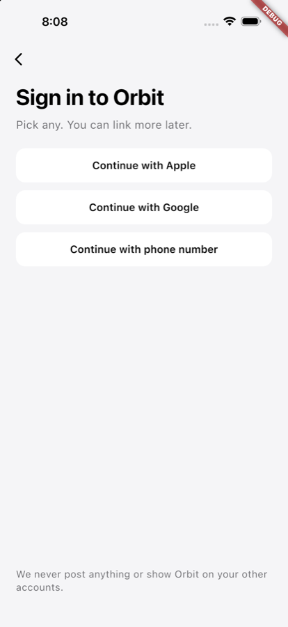</td>
<td>

1. On the Welcome screen, tap **Get started**.
2. Tap any of the three buttons. Locally, **Apple**, **Google** and **phone number** all open the same Keycloak page. In production each goes to its own provider.
3. On the Keycloak page, enter the username, then the password, and tap **Sign In**.
4. The first time, onboarding runs:
   - **Birthday:** pick a date at least 18 years ago. Only your age is ever shown.
   - **Make your profile:** a display name and what you're looking for. Photos can be added later.
   - **Location:** tap **Allow while using**. Your exact spot is never stored, only a rounded area.
5. You land on the **Nearby** grid.

</td></tr></table>

> **The server forgets everything when it stops.** After a restart, each phone has to sign in and go through onboarding again, and any photos and statuses are gone.

### 2.3 Adding more test users

1. Open `backend/src/test/resources/keycloak/orbit-realm.json`.
2. Copy the whole `dev-user-2` block in the `users` list, and give the copy a new `username`, `email` and password `value`. Use a generated value, never a real password.
3. Restart the server (`Ctrl+C`, then `./gradlew bootTestRun`).
4. Sign in with the new account on any phone. Onboarding creates its Orbit account and profile.

To call the API directly as `dev-user` (handy for scripts and debugging):

```bash
TOKEN=$(backend/scripts/dev-token.sh) && curl -H "Authorization: Bearer $TOKEN" localhost:8080/api/v1/me/profile
```

### 2.4 Signing out and switching account

**Me → Settings & privacy → Sign out.** Signing out clears everything about the member from the phone, including cached photos. Then sign in as someone else.

---

## 3. Finding your way around

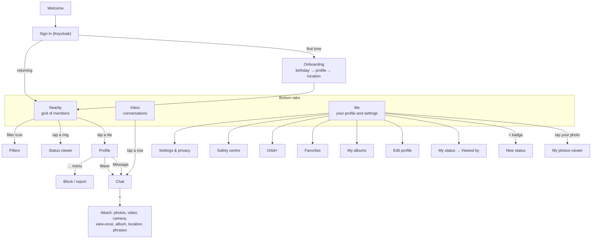

| Tab | What's there |
|---|---|
| **Nearby** | Fresh faces along the top, then a grid of members nearest first. The **Online** chip shows only members online now, and the slider icon opens filters. |
| **Inbox** | Your conversations, newest first, with **All**, **Unread** and **Favorites** tabs. The tab icon shows the unread count. |
| **Me** | Your photo and profile completeness, then your status, profile, albums, favorites, Orbit+, the Safety centre and Settings. |

**Gestures used throughout**

| Gesture | Where | Does |
|---|---|---|
| Pull down | Nearby grid | Refreshes |
| Swipe left or right | Photo viewers, profile photos | Next or previous photo |
| Pinch, or double-tap | Photo viewers | Zoom |
| Swipe down | Photo and status viewers | Closes |
| Tap right or left side | Status viewer | Next or previous status |
| Press and hold | Status viewer | Pauses |
| Press and hold | Your own chat message | Unsend (within 10 minutes) |
| Press and hold, then drag | Edit profile photos | Reorder |

The app follows the phone's **light or dark** setting and changes the moment you switch it.

---

## 4. Features

### 4.1 Nearby grid and profiles

<table><tr>
<td width="33%">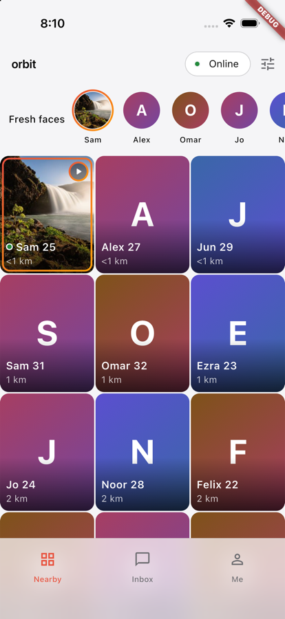</td>
<td width="33%">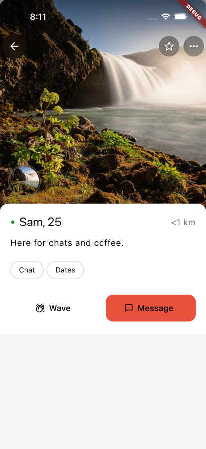</td>
<td width="33%">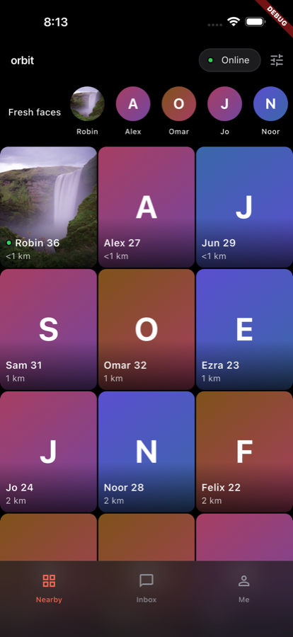</td>
</tr></table>

- **Tiles** show the member's photo edge to edge, with name, age, distance and an online dot. Members without a photo get a soft gradient with their initial.
- **Distance** is shown in rounded bands such as "<1 km", never as an exact figure, and members can hide it.
- A **coloured ring** means the member has a status you haven't seen. It turns grey once you've seen it all. Tap the small play badge to watch it, or anywhere else on the tile to open the profile.
- **Filters:** age, online now and has photo are free. Maximum distance and more filters come with Orbit+.
- **Profile:** swipe through the photos (the bars at the top show which one), tap the middle to open the full-screen viewer, and use the star to add a favorite or **…** to block or report.

### 4.2 Waves: two a day per person

<table><tr>
<td width="33%">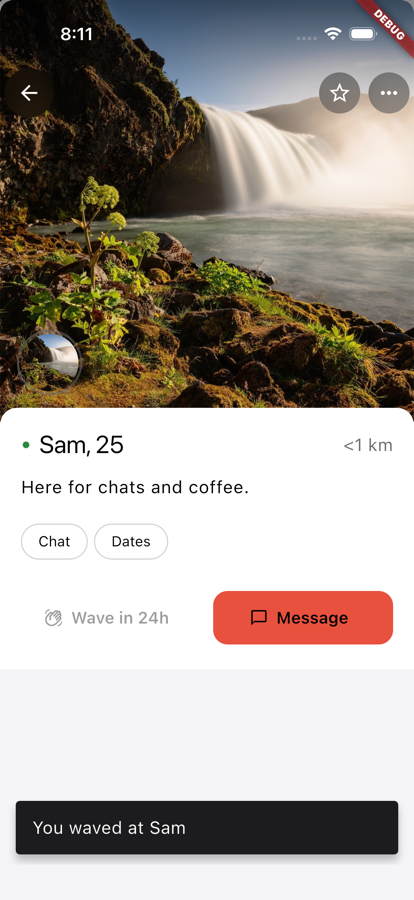</td>
<td>

A wave is a light "hi" without writing a message. To stop wave spam, you can wave at the same person **at most twice in any 24 hours**. The server enforces this, so it can't be bypassed.

- After two waves the button greys out and shows when you can wave again, such as **Wave in 24h**.
- Waves in a row show as one bubble in the chat, such as "Robin waved ×2".

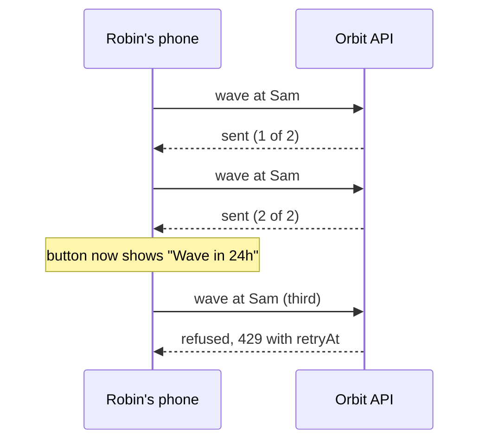

</td></tr></table>

### 4.3 Chat

<table><tr>
<td width="33%">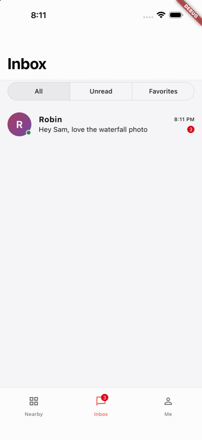</td>
<td width="33%">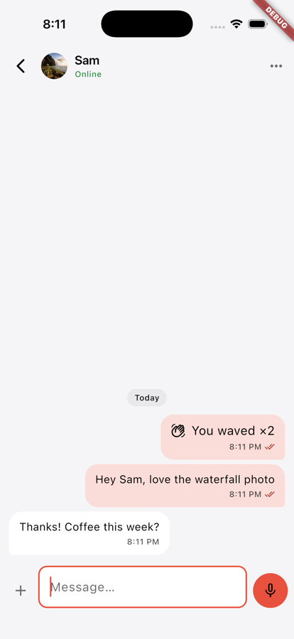</td>
<td width="33%">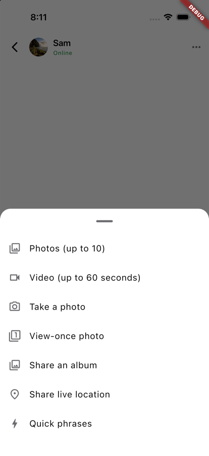</td>
</tr></table>

- **Bubbles** show the local time and ticks in the corner: a clock while sending, one grey tick when sent, and two red ticks once read. If either member turns read receipts off, the ticks stay grey.
- **Day separators** read "Today", "Yesterday", the weekday, or the date. Bubbles sent close together are grouped.
- The text box grows to five lines, and **Return** starts a new line. The round button is a **mic** when the box is empty and **send** once you type. Tap the mic to record a voice note, then tap again to send it, or discard it.
- **"+" attaches:**
  - Up to 10 photos at once, shown as a mosaic.
  - A video of up to 60 seconds.
  - A camera photo.
  - A **view-once** photo, which can be opened once and is never stored on the other phone.
  - A private album.
  - Your live location for 15, 30 or 60 minutes.
  - A quick phrase.
- **Unsend:** press and hold your own message within 10 minutes. For a photo mosaic, the sheet says how many photos will go.
- **Typing** and **online** show in the header, and tapping the header opens the profile.
- Messages arrive instantly over a live connection. Anything sent while a phone was offline arrives when it reconnects.

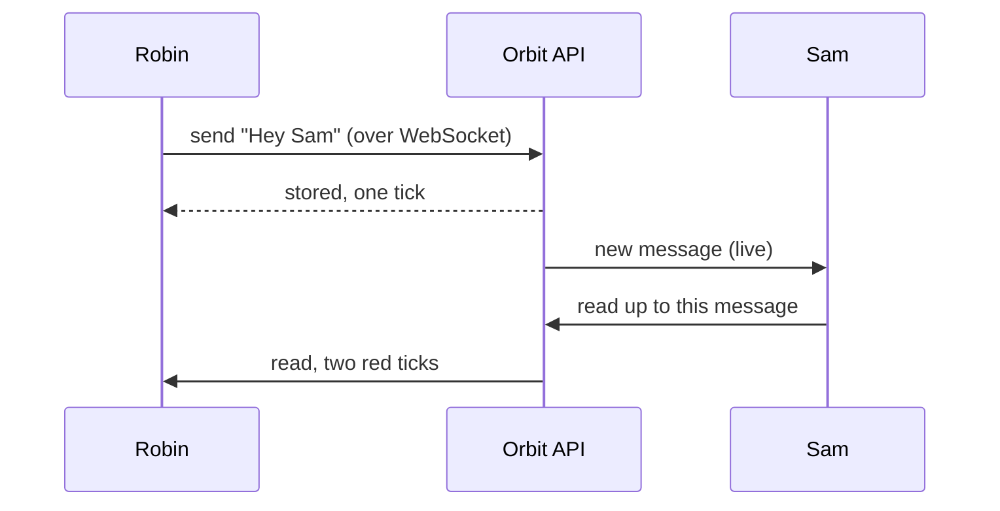

### 4.4 Your photos

<table><tr>
<td width="33%">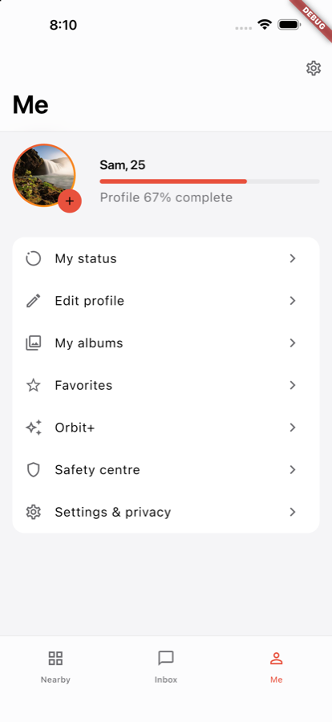</td>
<td width="33%">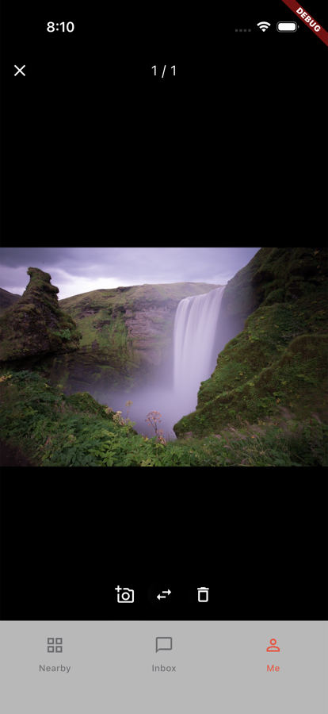</td>
<td>

- Tap your picture on **Me** to open your photos full screen. With no photos yet, the tap opens the photo picker instead.
- In the viewer:
  - **Add** a photo (up to 6).
  - **Replace** this photo.
  - **Make main**, so it shows first on your profile and tile.
  - **Delete**, after confirming.
- In **Edit profile**, press and hold a photo and drag it to reorder. The first photo is your main photo.
- Location and camera details are removed from every photo before it's uploaded.

</td></tr></table>

### 4.5 24-hour status

<table><tr>
<td width="25%">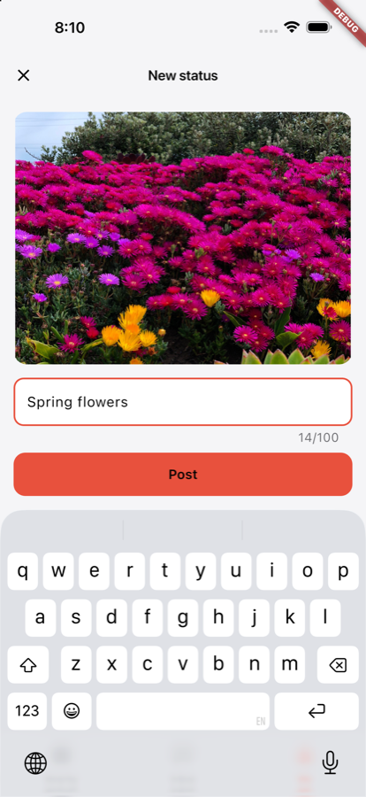</td>
<td width="25%"></td>
<td width="25%">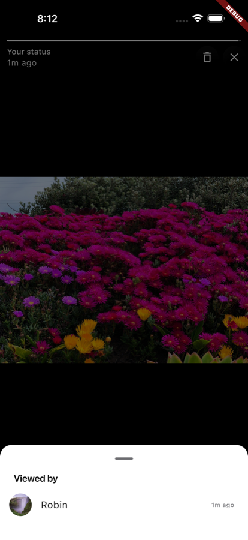</td>
</tr></table>

Post a photo that disappears after 24 hours, like a story.

- **Post:** tap the **+** badge on your Me picture, pick a photo, add a caption (up to 100 characters) and tap **Post**. The screen closes straight away, and a spinner on your picture shows the upload. You can have up to 10 live at once.
- **Who sees it:** anyone who can see your profile. Members you've blocked, or who blocked you, never see it.
- **Watching:** each status plays for 5 seconds. Tap the sides to move between statuses, hold to pause, swipe down to close. The flag reports it to the moderators.
- **Viewed by:** open **My status** and tap the 👁 count to see who watched and when. The bin icon deletes a status early.
- **After 24 hours** the status and its photo are deleted from the server. A reported status photo is kept for the moderators only.

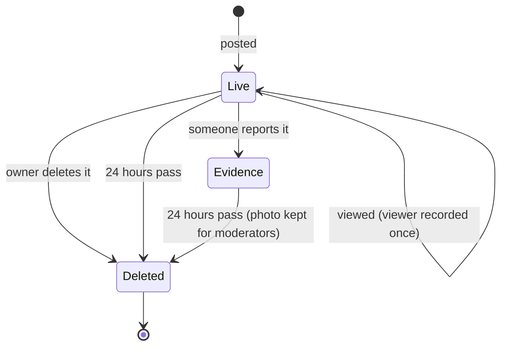

### 4.6 Albums

- **Me → My albums:** create an album, then add photos (several at a time, each with its own progress tile).
- Press and hold photos to select and delete them.
- Share an album from a chat (**+ → Share an album**), for a set time or until you revoke it. You can take access back at any time.
- If you have no albums yet, the share screen offers **Create album**.

### 4.7 Safety and privacy

<table><tr>
<td width="33%">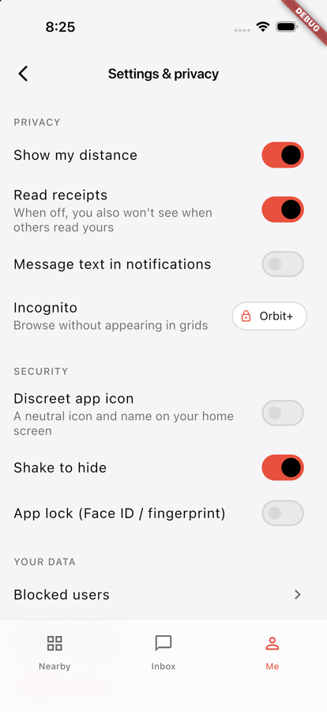</td>
<td>

- **Block** (profile **…** menu): instant and two-way. Neither of you sees the other anywhere, and they aren't told. Their cached photos are cleared from your phone.
- **Report:** pick a reason, and optionally block too. Reports go to a human moderator, and recent messages are kept as evidence.
- **Settings & privacy:**
  - Show my distance.
  - Read receipts. When they're off, you also can't see when others read yours.
  - Message text in notifications.
  - Incognito (Orbit+).
  - A discreet app icon.
  - Shake to hide.
  - App lock.
  - Blocked users, export my data, and delete account (14-day grace period).
- **Safety centre:** advice on meeting someone new, travel safety, sexual health, and how moderation works.
- If a member is suspended or banned, the app shows the reason and lets them appeal once.

</td></tr></table>

### 4.8 Orbit+

Orbit is always ad-free, and safety tools are free for everyone. Orbit+ adds:
- Distance and advanced filters.
- Incognito browsing.
- Unlimited favorites.
- See who viewed you.
- More profiles in the grid.

This build takes no payment: **Subscribe** turns Orbit+ on for testing.

---

## 5. The moderation console

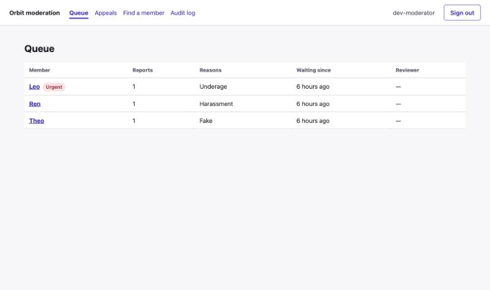

A web app where moderators review reports, look at evidence (recent messages and reported statuses), and warn, suspend, ban or reinstate members. Three fictional reports are filed when the local server starts, so the queue isn't empty.

With the server running:

```bash
cd admin && npm ci && npm run dev
```

Open <http://localhost:5174> and sign in as `dev-moderator`. A member who is suspended or banned sees it on their phone at once, and can appeal from the app. Appeals appear under **Appeals**.

---

## 6. Other ways to run

| Mode | Command | Use it when |
|---|---|---|
| **Demo, no server** | `cd mobile && flutter run --dart-define-from-file=config/demo.json` | You want to click around fast. Built-in fake members, no sign-in. Statuses and uploads are not available. |
| **Android emulator** | Forward the ports first, then run with `config/dev.json` (below) | Testing on Android |
| **One simulator** | `cd mobile && flutter run --dart-define-from-file=config/dev.json` | Trying things alone; the fictional members chat back |

Android needs the emulator's `localhost` forwarded to your Mac:

```bash
adb reverse tcp:8080 tcp:8080 && adb reverse tcp:8180 tcp:8180
```

---

## 7. Troubleshooting

| Problem | Fix |
|---|---|
| `bootTestRun` fails at start | Docker isn't running. Start Docker Desktop and try again. |
| Port 8080 or 8180 is already in use | An earlier server is still running. Stop it with `Ctrl+C`, or find it with `lsof -i :8080`. |
| Keycloak says "Invalid username or password" | The simulator sometimes drops the first characters typed. Wait a second after tapping a field, check the field shows the whole username, and retype. |
| Keycloak says "Your login attempt timed out" | The sign-in page sat open too long. Enter the details again on the same page. |
| The other member doesn't appear in Nearby | Both phones need a location near each other (step 1.4) and must have finished onboarding. Then pull down to refresh. |
| After restarting the server, the app is stuck or shows an error | The server's data was reset. Sign out (or delete and reinstall the app) and sign in again. |
| The app builds but can't reach the server | It was started without `--dart-define-from-file=config/dev.json`, so it's in demo mode. |
| Two `flutter run` commands fail together | Start the second only after the first has finished building. |
| A status ring doesn't appear | Pull down on Nearby to refresh. Rings come from the grid. |

---

## 8. Known issues

These were found in testing and are not fixed yet:

- **Chat header:** shows "online" and "typing", but not "last seen"; the server doesn't track it yet.
- **Me ring:** your own status ring can stay after it expires while the Me tab stays open. Tapping it clears it.
- **Blocking:** cached photos of a blocked member from earlier app sessions stay on the phone until sign-out or cache expiry.
