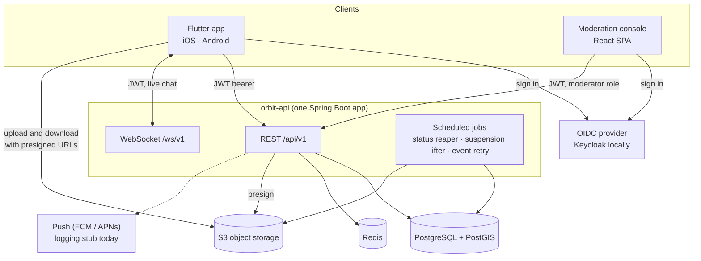

# Orbit: technical guide

Everything you need to understand before working on Orbit's code. To run the app, see [README.md](README.md). To deploy it, see [DEPLOYMENT.md](DEPLOYMENT.md). The reasoning behind the big choices is in [docs/adr/](docs/adr/) and [docs/design/design-doc.md](docs/design/design-doc.md).

**Contents**
1. [The three apps](#1-the-three-apps)
2. [Languages, tools and versions](#2-languages-tools-and-versions)
3. [System architecture](#3-system-architecture)
4. [Backend](#4-backend)
5. [Mobile app](#5-mobile-app)
6. [Moderation console](#6-moderation-console)
7. [Configuration reference](#7-configuration-reference)
8. [Testing](#8-testing)
9. [Working on the code](#9-working-on-the-code)

---

## 1. The three apps

| Folder | App | Language | Framework |
|---|---|---|---|
| [`backend/`](backend/) | The API: REST, WebSocket and background jobs | Java 21 | Spring Boot 4.1 with Spring Modulith 2.1 |
| [`mobile/`](mobile/) | The member app for iOS and Android | Dart 3.11 | Flutter 3.41 |
| [`admin/`](admin/) | The moderation console, used in a browser by staff | TypeScript 6 | React 19 on Vite 8 |

Other top-level folders: [`docs/`](docs/) holds design documents, ADRs, plans and README images, and [`.github/workflows/`](.github/workflows/) holds CI.

---

## 2. Languages, tools and versions

The build files are the source of truth for versions: `backend/build.gradle.kts`, `mobile/pubspec.yaml` and `admin/package.json`. Don't upgrade versions as a side effect of other work.

| Area | Tool | Version | Why it's used |
|---|---|---|---|
| Backend build | Gradle wrapper | in repo | Reproducible builds; run `./gradlew`, never a system Gradle |
| Backend runtime | Java (Temurin) | 21 | Virtual threads (on), records, pattern matching |
| Backend framework | Spring Boot | 4.1.2 | Web MVC, WebSocket, Security, Data JPA, Validation, Actuator |
| Module boundaries | Spring Modulith | 2.1.1 | Enforces module rules and stores domain events durably |
| Database | PostgreSQL + PostGIS | 17 + 3.5 | Relational data plus geospatial queries for "nearby" |
| Migrations | Flyway | via Boot | Versioned schema changes (`db/migration/V*.sql`) |
| Cache and presence | Redis | 7.4 | Online presence, rate limits |
| Object storage | S3 API (AWS SDK v2) | 2.57 | Photos, video and voice notes; S3Mock locally |
| Location cells | Uber H3 | 4.5.1 | Snaps locations to cells so exact positions are never stored |
| Sign-in | OpenID Connect | n/a | Keycloak locally; any OIDC provider in production |
| Backend style | Spotless (google-java-format) | 8.11 | Formatting is checked in CI |
| Backend tests | JUnit 5, AssertJ, Testcontainers | via Boot | Integration tests against real PostGIS, Redis, S3Mock |
| Mobile language | Dart | 3.11 | Sound null safety |
| Mobile UI | Flutter | 3.41.5 | One codebase for iOS and Android |
| Mobile state | Riverpod | 3.3 | Providers and notifiers; no global singletons |
| Mobile routing | go_router | 17.5 | Declarative routes and deep links |
| Mobile HTTP | dio | 5.11 | Typed API client with problem+json errors |
| Mobile sign-in | flutter_appauth | 12.1 | OIDC Authorization Code + PKCE |
| Mobile image cache | cached_network_image, flutter_cache_manager | 3.4, 3.5 | Caches photos by media id, not signed URL |
| Mobile media | image_picker, record, just_audio, video_player | see pubspec | Photos, voice notes, video |
| Mobile lint | very_good_analysis | 10.2 | Strict analyzer rules |
| Console UI | React | 19.3 | Component UI |
| Console data | TanStack Query | 5.108 | Server state, caching and retries |
| Console routing | React Router | 8.5 | Routes |
| Console sign-in | oidc-client-ts | 3.5 | OIDC Authorization Code + PKCE in the browser |
| Console validation | Zod | 4.6 | Validates API responses and build-time settings |
| Console tests | Vitest, Testing Library, MSW | 5.1, 16.3, 3.0 | Component tests with mocked network |
| CI | GitHub Actions | n/a | Builds and tests the backend and the mobile app on every push and PR |

---

## 3. System architecture



Key ideas:
- **One deployable, many modules.** The backend is a modular monolith: one Spring Boot app split into modules with strict boundaries, so a busy module can later move into its own service ([ADR-0001](docs/adr/0001-backend-framework-spring-boot.md)).
- **Tokens, not sessions.** Every request carries a JWT from the OIDC provider. The API keeps no per-user session state, so it scales horizontally.
- **Photos never pass through the API.** The API hands out short-lived presigned URLs (5 minutes to upload, 10 to view), and clients talk to object storage directly.
- **Live while open, push when away.** The WebSocket carries chat while the app is open. When a member has no live connection, a push notification is sent ([ADR-0004](docs/adr/0004-chat-transport.md)).
- **Location privacy.** Exact coordinates are snapped to H3 cells, distances are shown in bands, and updates are rate-limited ([ADR-0003](docs/adr/0003-location-privacy-and-battery.md)).

---

## 4. Backend

### 4.1 Modules

Each module is a package under `backend/src/main/java/com/orbit/`. Other modules may only use a module's **published API**: its `*Api.java` interface and the records and events declared in it. `ModularityTests` fails the build if a module reaches into another's internals or a dependency cycle appears.

| Module | Owns | Published API |
|---|---|---|
| `identity` | Accounts, mapping OIDC users to accounts, age gate, suspension and ban | `IdentityApi` |
| `profile` | Profiles, profile photos, tags | `ProfileApi` |
| `discovery` | Snapped locations, the nearby grid, favorites | n/a (only consumes) |
| `chat` | Conversations, messages, waves and the wave limit, the WebSocket gateway | `ChatApi` |
| `media` | Uploads, scanning, private albums, purge and evidence hold | `MediaApi` |
| `status` | 24-hour statuses, views, expiry | `StatusApi` |
| `safety` | Blocks and reports | `SafetyApi` |
| `moderation` | The moderation queue, actions, appeals, evidence, audit log | n/a |
| `notification` | Device registration and pushes | n/a |
| `billing` | Orbit+ entitlements (placeholder) | n/a |
| `shared` | Security, error mapping, scheduling and event retry; no business logic | n/a |

Every module uses the same four layers inside:

| Package | Contains | May depend on |
|---|---|---|
| `api` | REST controllers, request and response records, exception-to-problem mapping | `application` |
| `application` | Services, business rules, transactions, scheduled jobs, event listeners | `domain`, `infrastructure`, other modules' `*Api` |
| `domain` | Value types and rules with no framework code | nothing |
| `infrastructure` | SQL (JdbcClient), S3 and other adapters | `domain` |

### 4.2 Requests and errors

- All endpoints are under `/api/v1`. The WebSocket is `/ws/v1`.
- Errors use RFC 9457 `application/problem+json`, with a `type` of `urn:orbit:problem:<name>`. Examples: `wave-limit` (429, with `retryAt` and `Retry-After`), `status-limit` (409), `status-not-found` (404) and `account-restricted` (403). Clients branch on `type`, never on message text.
- Input is validated with Bean Validation at the controller boundary.
- `/api/v1/admin/**` needs the `MODERATOR` role, which is mapped from the OIDC realm role `moderator`.
- Health checks: `/actuator/health/liveness` and `/actuator/health/readiness`.

To list every endpoint:

```bash
grep -rhE "@(Get|Post|Put|Delete)Mapping|@RequestMapping" backend/src/main/java
```

### 4.3 Data and migrations

The schema lives in `backend/src/main/resources/db/migration`, applied by Flyway at start-up. Hibernate only validates it (`ddl-auto: validate`).

| Migration | Adds |
|---|---|
| V1 | PostGIS extension |
| V2 | Spring Modulith event publication table |
| V3–V9 | Accounts, safety, profiles, discovery, chat, devices, media |
| V10 | Media messages in chat |
| V11 | Moderation, appeals, evidence, audit |
| V12 | Index for the wave limit |
| V13 | Status photo purpose, evidence hold, `PURGING` state |
| V14 | Statuses and status views |

Rules:
- **Never edit a migration that has shipped.** Add a new `V<n>__description.sql`.
- Every change must work during a rolling deploy, with old and new code running side by side: expand, then migrate, then contract.
- Times are stored and sent in UTC; the app converts to local time for display.

### 4.4 Events and background jobs

Modules talk to each other asynchronously through domain events, stored by Spring Modulith in `event_publication` so they survive a crash.

| Event | Published by | Handled by |
|---|---|---|
| `ReportFiled` | safety | moderation, which copies evidence in the same transaction |
| `StatusExpired` | status (on early delete or expiry) | status → `MediaApi.purge`, outside any transaction |
| `AccountRestricted` | identity | chat (closes live sockets) |
| Message sent | chat | notification (push when the member is offline) |

| Job | Interval | Does |
|---|---|---|
| `StatusReaper` | every minute | Deletes expired statuses in batches of 500 and publishes `StatusExpired` |
| `SuspensionLifter` | every minute | Lifts suspensions that have ended |
| `EventResubmissionJob` | every 5 minutes | Retries failed `StatusExpired` handling only. Other modules' listeners aren't safe to repeat. |

Jobs are safe to run on several servers at once. Scheduling can be switched off with `orbit.scheduling.enabled=false`; tests do this and call jobs directly.

### 4.5 Running and checking the backend

| Command (in `backend/`) | Does |
|---|---|
| `./gradlew bootTestRun` | Runs the API with throwaway Docker containers, seed data and Keycloak (see [README](README.md)) |
| `./gradlew build` | Format check, compile with warnings as errors, and all tests. Run this before every commit. |
| `./gradlew spotlessApply` | Fixes formatting |
| `./gradlew test --tests '*StatusIntegrationTests*'` | Runs one test class |

---

## 5. Mobile app

### 5.1 Structure

```
mobile/lib/
├── app/            app shell: theme, router, session, bottom tabs, environment
├── core/           shared code: auth, API client, reusable widgets
├── features/       one folder per feature
│   └── <feature>/
│       ├── data/          repositories that call the API (and fake ones for demo mode)
│       ├── domain/        plain Dart models and rules
│       └── presentation/  screens, widgets and Riverpod providers/controllers
└── l10n/           translations (app_en.arb) and generated code
```

Features: `onboarding`, `discovery`, `chat`, `status`, `profile`, `albums`, `media`, `safety`, `settings`, `standing` (suspension and ban), `plus`.

### 5.2 Key patterns

- **State is Riverpod.** Screens watch providers, and controllers (`Notifier` / `AsyncNotifier`) hold logic. Everything about the signed-in member is reset in `SessionController.signOut()`. **When you add a per-member provider, add it there too.**
- **Two data modes.** Each repository has an API version and a fake version. Which one is used is decided by `AppEnv.usesApi`, which is true when `ORBIT_API_BASE_URL` is set.
- **Errors.** The API client turns problem responses into `ApiException` with `status`, `type` and `retryAt`. UI code branches on `type`.
- **Chat transport.** `ApiChatGateway` keeps one WebSocket open while the app is in the foreground. It reconnects with back-off and catches up from the last message it saw, and falls back to REST to send while disconnected.
- **Images.** Always show photos with `MediaImage`, keyed by media id plus `thumb` or `full`. Signed URLs change on every request, so caching by URL would never hit. View-once photos are never cached, and status photos use a 24-hour cache.
- **Theme.** Colours come only from `OrbitTokens` in `app/theme.dart`, read as `context.tokens`. Light and dark tokens follow the phone. A test fails if a hard-coded colour appears anywhere else, unless the line is marked `// photo-overlay`.
- **Text.** All user-facing text lives in `lib/l10n/app_en.arb`. After editing it, run `flutter gen-l10n`.
- **Accessibility.** Every control has a tooltip or semantics label, text and icons meet WCAG AA contrast (tested), touch targets are at least 44 points, and animations respect "reduce motion".

### 5.3 App configuration

The app is configured at build time with `--dart-define-from-file`:

| File | `ORBIT_FLAVOR` | API | Notes |
|---|---|---|---|
| `config/demo.json` | `demo` | none | Built-in fake data, no sign-in. Used by tests. |
| `config/dev.json` | `dev` | `http://localhost:8080` | Local Keycloak on 8180 |
| `config/staging.json` | `staging` | to be filled in | See [DEPLOYMENT.md](DEPLOYMENT.md) |
| `config/prod.json` | `prod` | to be filled in | See [DEPLOYMENT.md](DEPLOYMENT.md) |

| Key | Meaning | Default |
|---|---|---|
| `ORBIT_FLAVOR` | Environment name | `demo` |
| `ORBIT_API_BASE_URL` | API origin; empty means demo mode | empty |
| `ORBIT_OIDC_ISSUER` | OIDC issuer URL | none |
| `ORBIT_OIDC_CLIENT_ID` | OIDC client | `orbit-mobile` |
| `ORBIT_OIDC_REDIRECT_URI` | OIDC redirect | `com.orbit.orbit:/oauthredirect` |

Plain `http://` is only allowed for `localhost` and the Android emulator's `10.0.2.2`. The bundle and application id is `com.orbit.orbit`.

### 5.4 Commands (in `mobile/`)

| Command | Does |
|---|---|
| `flutter pub get` | Installs packages |
| `dart format --set-exit-if-changed .` | Format check |
| `flutter analyze` | Static analysis; must report no issues |
| `flutter test` | All tests, including golden screenshot tests |
| `flutter test --update-goldens test/goldens` | Regenerates golden images after a deliberate visual change. Review the PNGs before committing them. |
| `flutter gen-l10n` | Regenerates translations |

---

## 6. Moderation console

- **Structure:** `admin/src/app` holds the shell, router and sign-in; `admin/src/features` holds `queue`, `members`, `appeals` and `audit`; `admin/src/shared` holds the API client and environment.
- **Sign-in:** OIDC Authorization Code + PKCE with `oidc-client-ts` and the `orbit-admin` client. The API checks the moderator role on every request.
- **API access:** in development, Vite proxies `/api` to `localhost:8080`. In production the console and API are served from one origin, so no CORS rules are needed ([ADR-0007](docs/adr/0007-moderation-and-admin-console.md)).
- **Settings** are read at build time and validated with Zod, so a bad build fails loudly:

| Variable | Example (local) |
|---|---|
| `VITE_OIDC_AUTHORITY` | `http://localhost:8180/realms/orbit` |
| `VITE_OIDC_CLIENT_ID` | `orbit-admin` |

Local values are in `admin/.env.development`, and `admin/.env.example` shows the shape.

To run it, see [README §5](README.md#5-the-moderation-console). To check it the way CI should, run this in `admin/`:

```bash
npm run lint && npm run typecheck && npm test && npm run build
```

---

## 7. Configuration reference

The backend reads `backend/src/main/resources/application.yml`, and environment variables override it using Spring's relaxed binding: `orbit.media.bucket` becomes `ORBIT_MEDIA_BUCKET`. The app **fails at start-up** if a required value is missing or invalid. Values per environment are in [DEPLOYMENT.md](DEPLOYMENT.md).

| Setting | Required | Default | Meaning |
|---|---|---|---|
| `SPRING_DATASOURCE_URL` / `_USERNAME` / `_PASSWORD` | yes | n/a | PostgreSQL with PostGIS |
| `SPRING_DATA_REDIS_URL` | yes | n/a | Redis |
| `SPRING_SECURITY_OAUTH2_RESOURCESERVER_JWT_ISSUERURI` | yes | n/a | The OIDC issuer whose tokens are accepted |
| `SPRING_SECURITY_OAUTH2_RESOURCESERVER_JWT_AUDIENCES` | yes | n/a | The accepted token audience |
| `ORBIT_MEDIA_BUCKET` | yes | n/a | Object storage bucket |
| `ORBIT_MEDIA_REGION` | yes | `us-east-1` | Storage region |
| `ORBIT_MEDIA_ENDPOINT` | no | AWS | A custom S3 endpoint (S3Mock, MinIO, R2 and so on) |
| `ORBIT_MEDIA_PATHSTYLE` | no | `false` | Path-style URLs, needed by most non-AWS storage |
| `ORBIT_MEDIA_ACCESSKEY` / `_SECRETKEY` | no | AWS default chain | Static keys. Prefer the platform's IAM role instead. |
| `ORBIT_MEDIA_UPLOADTTL` / `_VIEWTTL` | no | `PT5M` / `PT10M` | How long presigned URLs last |
| `ORBIT_CHAT_ALLOWEDORIGINS` | no | none | Browser origins allowed on the WebSocket; native apps need none |
| `ORBIT_CHAT_WAVELIMIT` / `_WAVEWINDOW` | no | `2` / `PT24H` | Waves per person per window |
| `ORBIT_SCHEDULING_ENABLED` | no | `true` | Turns all scheduled jobs on or off |
| `ORBIT_EVENTS_RESUBMISSION_INTERVAL` / `_MINAGE` | no | `PT5M` / `PT5M` | How often and how old failed status-expiry events are retried |

Secrets (database password, storage keys) always come from a secret manager or the environment. Never put them in a file in the repo.

---

## 8. Testing

| Layer | Where | Runs against |
|---|---|---|
| Backend unit tests | `backend/src/test/java/**/domain` | Plain JUnit |
| Backend integration tests | `*IntegrationTests.java` | Real PostGIS, Redis and S3Mock in Testcontainers, with a controllable clock (`MutableClock`) |
| Module rules | `ModularityTests` | Spring Modulith verification |
| Mobile unit and widget tests | `mobile/test/` | Fake API (`test/helpers/fake_api.dart`), fake gateways, fake image cache |
| Mobile golden tests | `mobile/test/goldens/` | The main screens in light and dark, compared pixel by pixel |
| Console tests | `admin/src/**/*.test.tsx` | Vitest, Testing Library and MSW |

Conventions:
- **Bug fixes need tests.** Every bug fix comes with a test that fails before the fix.
- **No sleeps.** Tests use fake clocks, Awaitility or explicit waits, never `sleep`.
- **Clean output.** Test output must be free of warnings.
- **Goldens are made on macOS.** They may differ slightly on other systems; regenerate on the machine that runs them in CI before relying on them there.

---

## 9. Working on the code

- **Branches and commits:** short-lived branches (`feat/…`, `fix/…`, `chore/…`) and [Conventional Commits](https://www.conventionalcommits.org/). The subject is imperative and at most 72 characters, and the body says why.
- **Before you commit**, run the checks for every app you touched: backend `./gradlew build`; mobile `dart format`, `flutter analyze` and `flutter test`; console lint, typecheck, test and build.
- **Adding a backend feature:**
  1. Put it in the module that owns the data.
  2. Expose only what other modules need through its `*Api`.
  3. Add a migration.
  4. Add an integration test.
  5. Map new errors to a `urn:orbit:problem:*` type.
- **Adding a mobile screen:**
  1. Add a route in `app/router.dart`.
  2. Add strings to `app_en.arb`.
  3. Use theme tokens for every colour.
  4. Reset any per-member state on sign-out.
  5. Add a widget test.
- **Dependencies:** add a new package only when nothing in the stack already covers the need, and say why in the commit.
- **Privacy rules that are easy to break:**
  - Never log message text, captions, tokens, media URLs or coordinates.
  - Never store an exact location.
  - Never cache view-once media.
