# Orbit — System Design Document

> **Orbit** is a working title. Before launch, run a trademark and app-store name check.
> Status: Draft v0.1 · 2026-11-09 · Owner: tech lead

Orbit is an original, location-based social and dating app for gay, bi, trans and queer people, for iOS and Android. It covers the same core needs as incumbent apps — finding people nearby, profiles, chat and private photos — and is built to be **fast, light on battery, ad-free and private by default**.

This is a clean-room design. It uses no code, assets, APIs or branding from any existing app.

Related: [ADR-0001 backend](../adr/0001-backend-framework-spring-boot.md) · [ADR-0002 Flutter](../adr/0002-mobile-client-flutter.md) · [ADR-0003 location](../adr/0003-location-privacy-and-battery.md) · [ADR-0004 chat](../adr/0004-chat-transport.md) · [Wireframes](wireframes.md) · [Delivery plan](../plan.md)

---

## 1. Goals and non-goals

### 1.1 Goals

| Goal | Measurable target |
|---|---|
| **Fast** | Cold start under 1.5 s on a mid-range Android (Pixel 6a class). Grid first content under 800 ms (p95) on 4G. Grid API under 150 ms (p95) on the server. Scrolling at 60 fps with no frame over 16 ms. |
| **Battery-light** | No more than 3% battery per hour with the app open and idle. Close to 0% in the background, because no background location or socket runs. |
| **Ad-free** | No ad SDKs, ever. Revenue comes from an optional "Orbit+" subscription. |
| **Private by default** | No exact location stored. Distances shown in buckets. Push notifications carry no message text unless the user opts in. Data export and deletion within 30 days. |
| **Safe** | Block and report in two taps. Age 18+ gate. Safety defaults that switch on in high-risk regions. Human moderation backed by automated tools. |

### 1.2 Non-goals for v1

- Video or voice calls (v2 or later).
- Group chats and events (v2 or later).
- A web client (v2 or later).
- Algorithmic swipe-style matching. v1 is a grid sorted by distance, plus filters.

---

## 2. Feature set (v1)

| Area | Features |
|---|---|
| **Onboarding** | Sign in with Apple, Google or phone OTP. Age gate (18+). Profile setup wizard. Permission primers before the system prompts. |
| **Discovery** | Grid of nearby profiles (3 columns, infinite scroll). Online indicator. Filters for age, "looking for", tribes and tags, online now and has photo. Favorites. "Fresh faces". |
| **Profile** | Up to 6 public photos. Display name, bio, age, height and weight (optional), "looking for", tags, pronouns, relationship status, and sexual health fields (optional, private by default). |
| **Interactions** | Wave, a lightweight "hi" signal. Favorite. Block. Report. |
| **Chat** | 1:1 text, photos, timed location share (15 minutes to 1 hour), read receipts (can be turned off), typing indicator, unsend within 10 minutes, quick phrases. |
| **Albums** | Private albums. Share an album with a person and revoke access. View-once photos. |
| **Safety** | Safety centre, panic-hide (shake to hide), discreet app icon, screenshot warning on iOS, and blocking screenshots of chat on Android (FLAG_SECURE). |
| **Account** | Settings, privacy toggles, notification preferences, data export, deletion, Orbit+ subscription. |
| **Orbit+ (optional)** | More profiles in the grid, advanced filters, incognito browsing, "viewed me", unlimited favorites. **Safety features are never behind the paywall.** |

---

## 3. System context

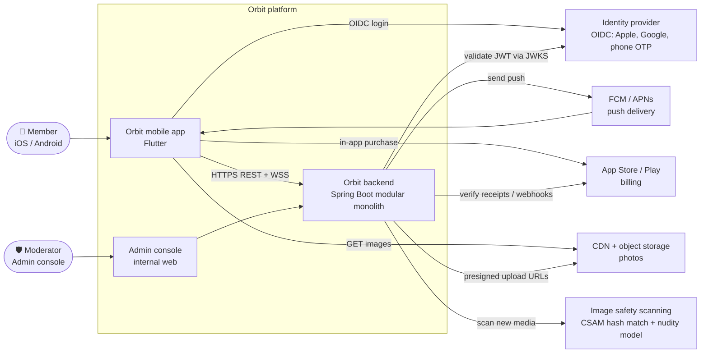

---

## 4. Container architecture

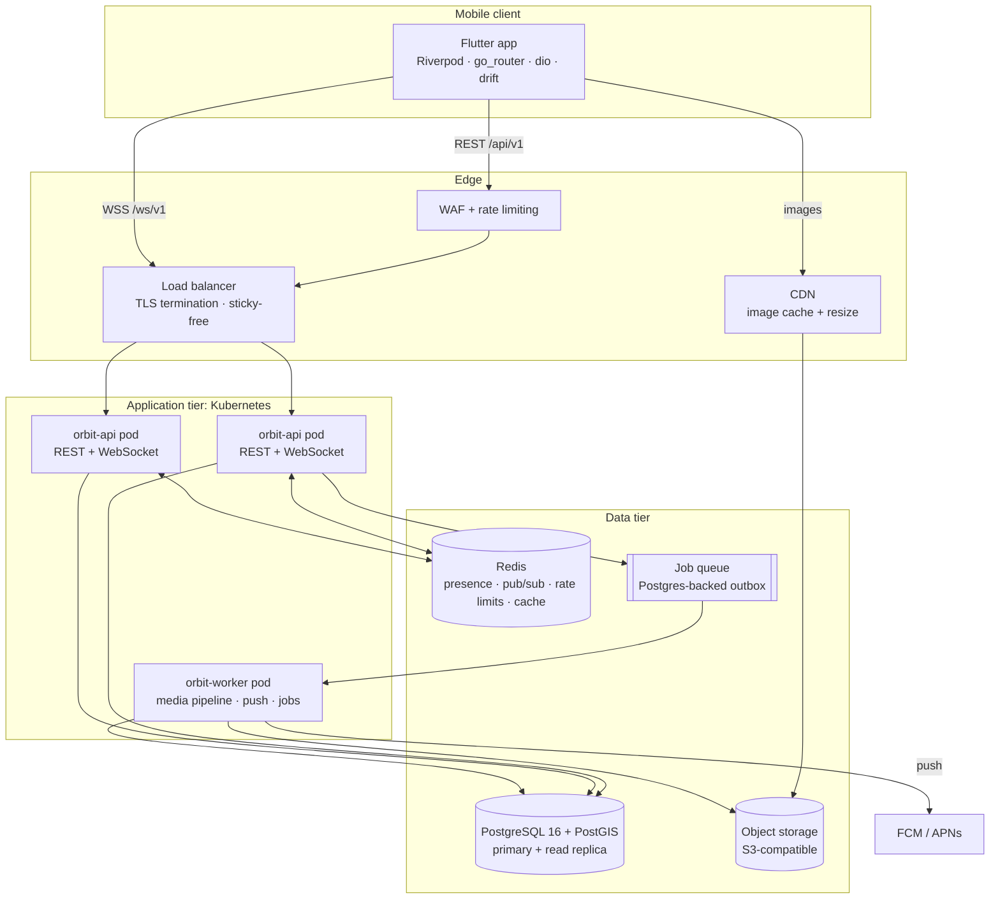

**Why a modular monolith:** one deployable is the fastest way to ship with a small team. Spring Modulith enforces module boundaries, so a hot module — most likely `chat` — can be split out later without a rewrite. See ADR-0001.

---

## 5. Backend module design

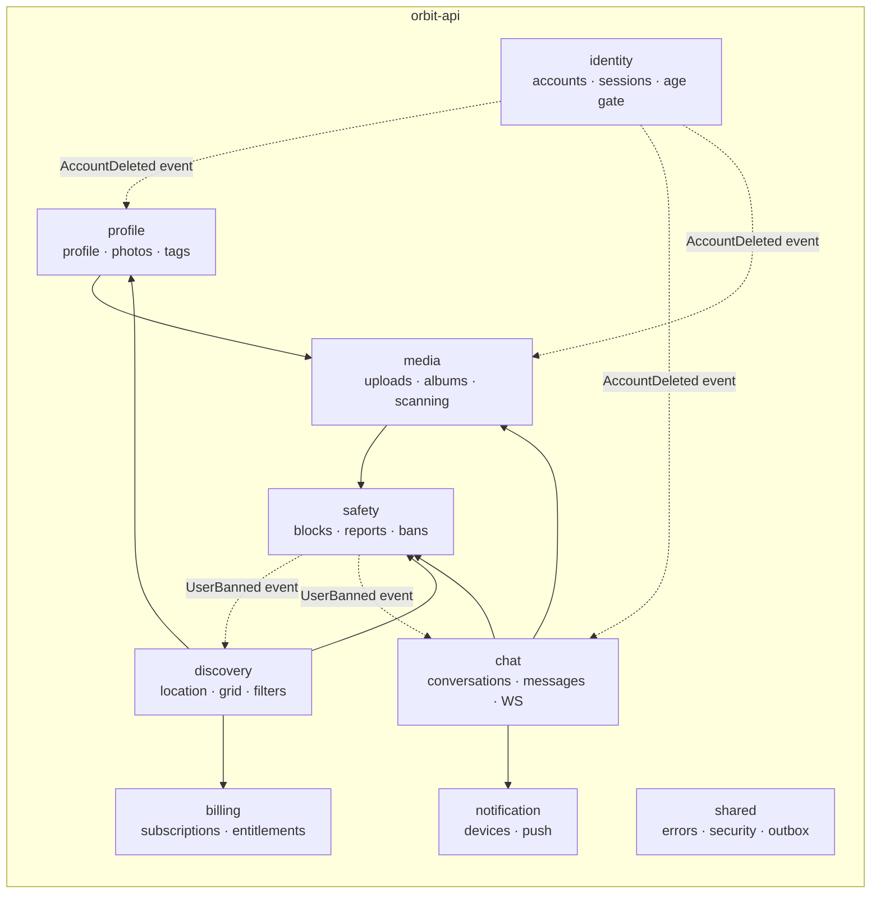

Solid arrows are synchronous calls to another module's `application` API. Dotted arrows are domain events published through a transactional outbox. Each module follows `standards/springboot.md` §1:

```
com.orbit
├── OrbitApplication.java
├── identity/   { api, application, domain, infrastructure }
├── profile/    { api, application, domain, infrastructure }
├── discovery/  { ... }
├── chat/       { ... }
├── media/      { ... }
├── safety/     { ... }
├── notification/
├── billing/
└── shared/     { error (ProblemDetail), security, outbox, config }
```

**Block rule (applies everywhere):** every read path in `discovery`, `chat`, `profile` and `media` calls `SafetyApi.isBlockedEitherWay(a, b)`. In practice this is a SQL `NOT EXISTS` join, not a per-row call. Neither user in a block can see the other anywhere in the app.

---

## 6. Data model

```mermaid
erDiagram
    ACCOUNT ||--|| PROFILE : has
    ACCOUNT ||--o{ DEVICE : registers
    ACCOUNT ||--o| USER_LOCATION : "last known (snapped)"
    PROFILE ||--o{ PHOTO : "public photos"
    ACCOUNT ||--o{ ALBUM : owns
    ALBUM ||--o{ ALBUM_ITEM : contains
    ALBUM ||--o{ ALBUM_GRANT : "shared with"
    ACCOUNT ||--o{ FAVORITE : "favorites"
    ACCOUNT ||--o{ BLOCK : "blocks"
    ACCOUNT ||--o{ REPORT : "files"
    ACCOUNT ||--o{ CONVERSATION_MEMBER : "is in"
    CONVERSATION ||--|{ CONVERSATION_MEMBER : has
    CONVERSATION ||--o{ MESSAGE : contains
    ACCOUNT ||--o{ WAVE : sends
    ACCOUNT ||--o| SUBSCRIPTION : "may have"

    ACCOUNT {
        uuid id PK
        text idp_subject UK
        date birth_date
        text status "ACTIVE|SUSPENDED|BANNED|DELETING"
        text region_policy
        timestamptz created_at
        timestamptz updated_at
    }
    PROFILE {
        uuid account_id PK,FK
        text display_name
        text bio
        smallint age_cached
        smallint height_cm
        text[] looking_for
        text[] tags
        text pronouns
        boolean show_distance
        boolean show_age
        timestamptz updated_at
    }
    PHOTO {
        uuid id PK
        uuid account_id FK
        smallint position
        text storage_key
        text moderation_state "PENDING|APPROVED|REJECTED"
        timestamptz created_at
    }
    USER_LOCATION {
        uuid account_id PK,FK
        geography point "snapped H3 res-8 + per-user offset"
        text h3_cell
        timestamptz updated_at
    }
    CONVERSATION {
        uuid id PK
        timestamptz last_message_at
        timestamptz created_at
    }
    CONVERSATION_MEMBER {
        uuid conversation_id PK,FK
        uuid account_id PK,FK
        bigint last_read_seq
        boolean muted
        timestamptz deleted_at
    }
    MESSAGE {
        uuid id PK
        uuid conversation_id FK
        bigint seq
        uuid sender_id FK
        uuid client_msg_id UK
        text kind "TEXT|PHOTO|LOCATION|ALBUM_SHARE"
        jsonb body
        timestamptz created_at
        timestamptz unsent_at
    }
    BLOCK {
        uuid blocker_id PK,FK
        uuid blocked_id PK,FK
        timestamptz created_at
    }
    REPORT {
        uuid id PK
        uuid reporter_id FK
        uuid subject_id FK
        text reason
        text status "OPEN|ACTIONED|DISMISSED"
        timestamptz created_at
    }
    ALBUM {
        uuid id PK
        uuid owner_id FK
        text name
    }
    ALBUM_ITEM {
        uuid id PK
        uuid album_id FK
        text storage_key
        boolean view_once
    }
    ALBUM_GRANT {
        uuid album_id PK,FK
        uuid grantee_id PK,FK
        timestamptz expires_at
    }
    FAVORITE {
        uuid owner_id PK,FK
        uuid target_id PK,FK
    }
    WAVE {
        uuid id PK
        uuid from_id FK
        uuid to_id FK
        timestamptz created_at
    }
    DEVICE {
        uuid id PK
        uuid account_id FK
        text platform
        text push_token
        timestamptz last_seen_at
    }
    SUBSCRIPTION {
        uuid account_id PK,FK
        text store
        text product_id
        timestamptz expires_at
    }
```

**Key indexes**

| Table | Index | Purpose |
|---|---|---|
| `user_location` | `GIST (point)` | Nearest-neighbour grid query (`<->`) and `ST_DWithin` |
| `user_location` | `(h3_cell)` | Coarse pre-filter and region policy |
| `message` | `(conversation_id, seq)` unique, partitioned by month | Cursor pagination |
| `message` | `(client_msg_id)` unique | Idempotent send |
| `block` | `(blocked_id, blocker_id)` | Checking blocks in both directions |
| `conversation_member` | `(account_id, conversation_id)` | Inbox |
| `photo` | `(account_id, position)` | Profile load |

All timestamps are UTC `timestamptz`. Flyway manages every schema change. Migrations follow expand, migrate, contract.

---

## 7. Key flows

### 7.1 Sign-up and onboarding

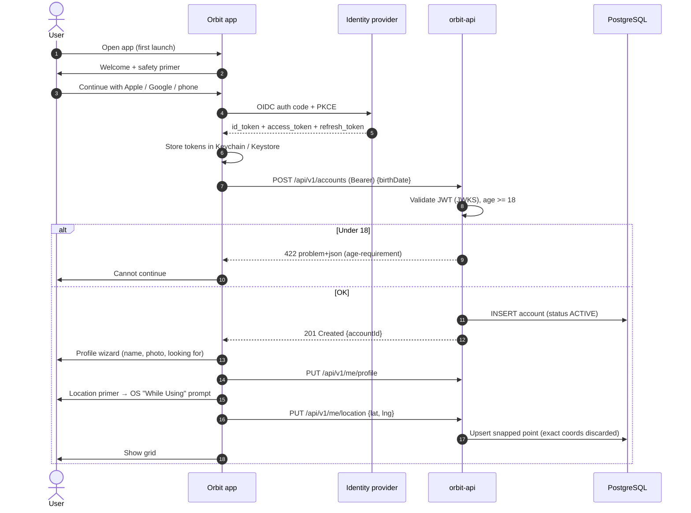

### 7.2 Location update and grid fetch (fast path)

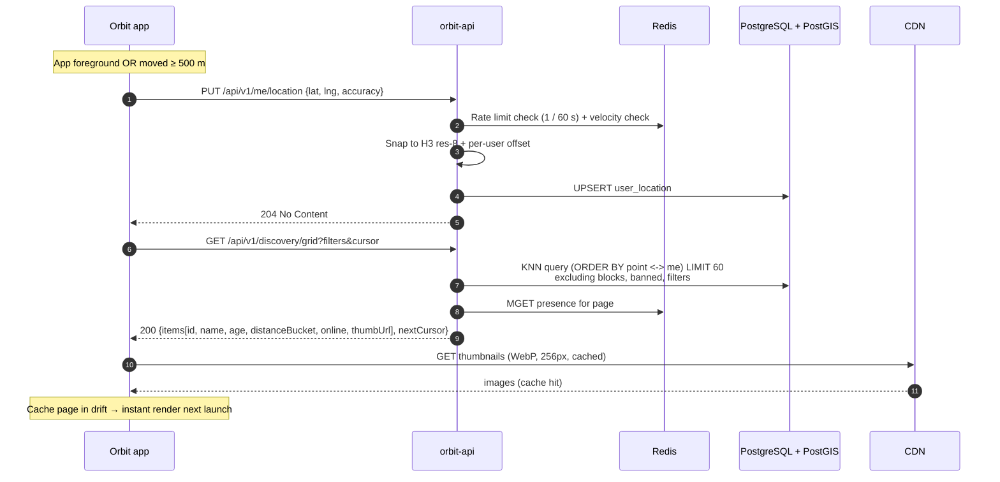

### 7.3 Sending a message (recipient online or offline)

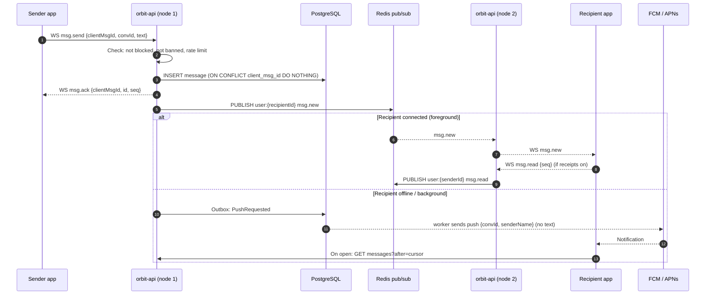

### 7.4 Photo upload with safety scanning

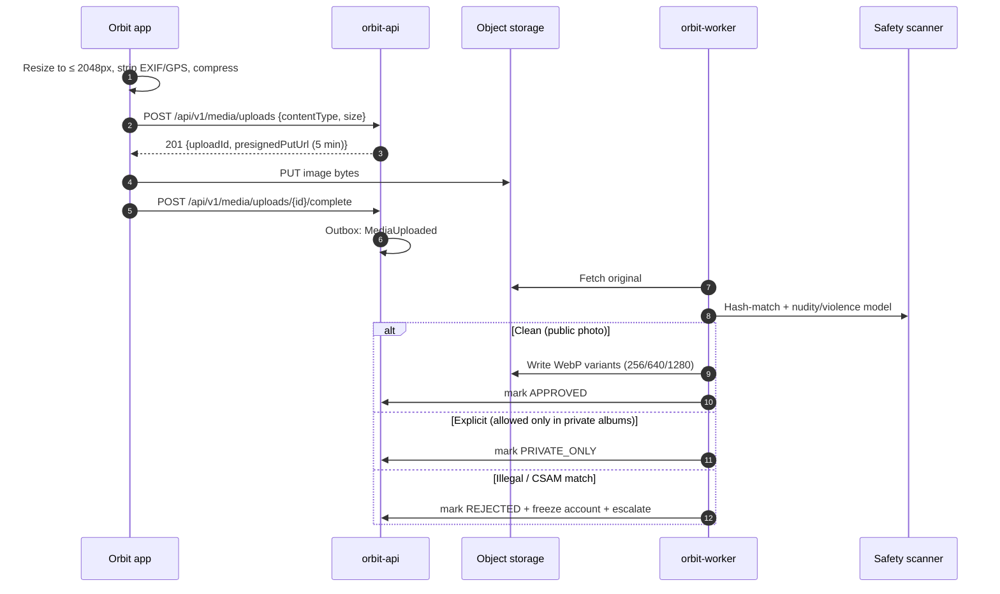

### 7.5 Block and report

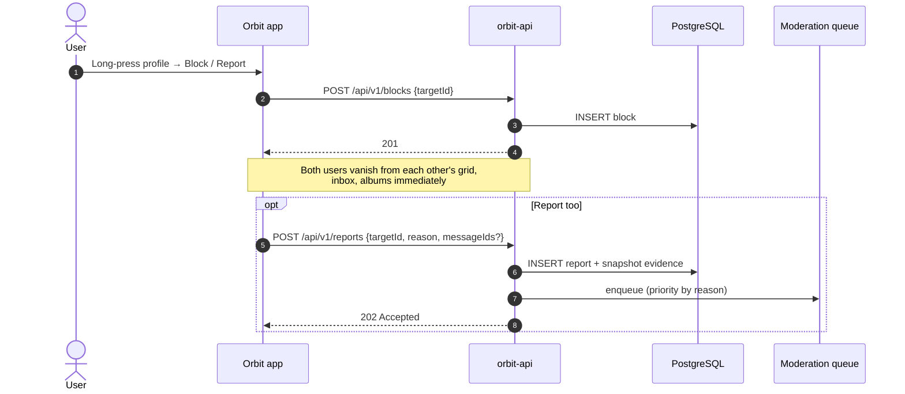

### 7.6 Token refresh and WebSocket reconnect

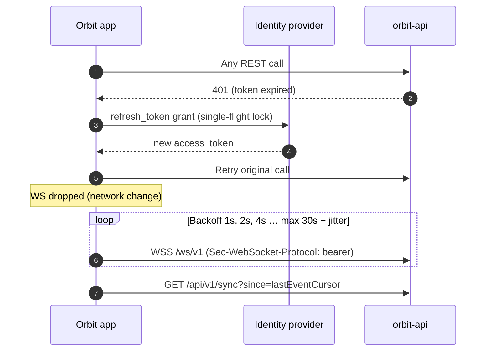

---

## 8. State machines

### 8.1 Account lifecycle

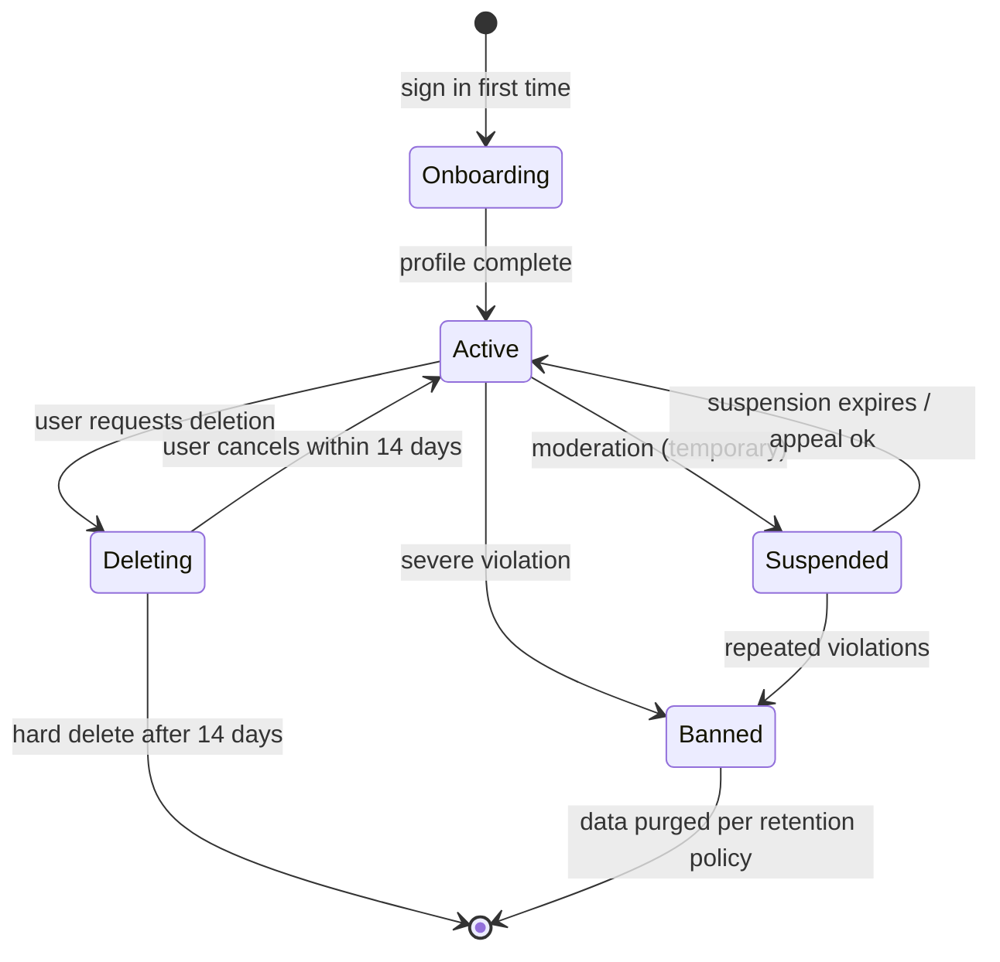

### 8.2 Message status (sender's view)

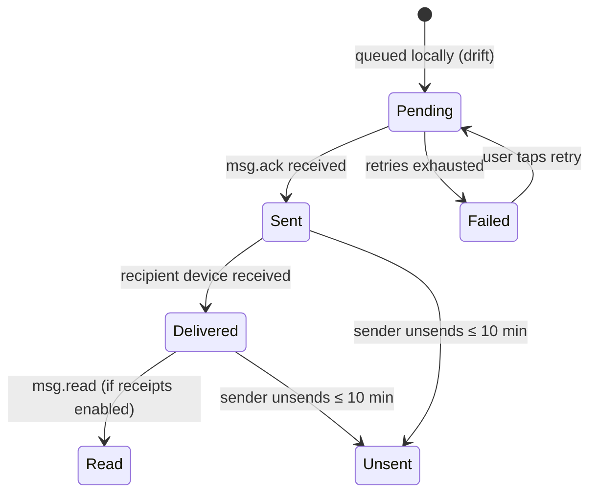

### 8.3 Report moderation

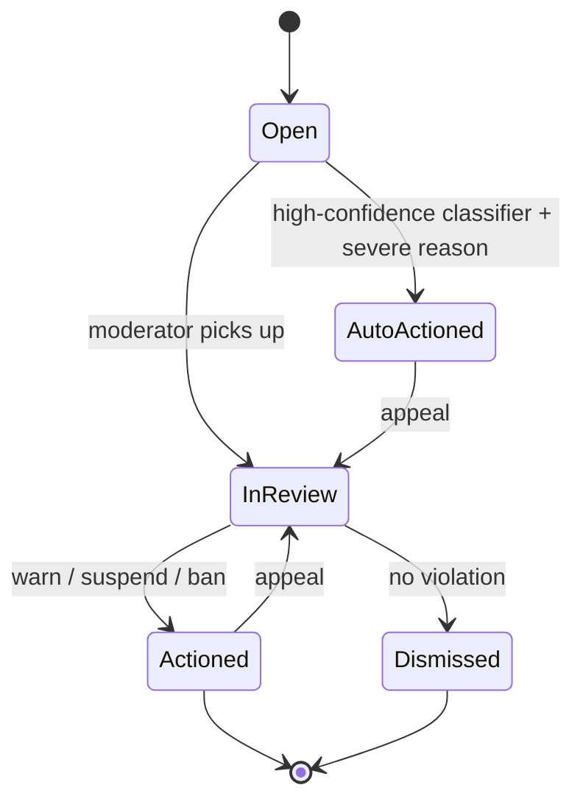

---

## 9. API surface (REST, `/api/v1`)

All errors use `application/problem+json` (RFC 9457). Every collection uses cursor pagination with a maximum page size of 60. Writes that clients may retry take an `Idempotency-Key` header.

| Method | Path | Purpose |
|---|---|---|
| POST | `/accounts` | Create account after OIDC login. `201` + `Location: /api/v1/me`; `422 urn:orbit:problem:age-requirement` if under 18; `409 urn:orbit:problem:account-exists` if this sign-in already has one |
| GET | `/me` | Own account (`id`, `status`, `createdAt`); `404 urn:orbit:problem:account-not-found` means onboarding is needed |
| GET / PUT | `/me/profile` | Read or update own profile |
| PUT | `/me/location` | Report position (server snaps it) |
| GET | `/me/settings` · PATCH `/me/settings` | Privacy and notification settings |
| POST | `/me/export` | Request data export (async) |
| DELETE | `/me` | Start account deletion (14-day grace period) |
| GET | `/discovery/grid` | Nearby grid (filters, cursor) |
| GET | `/profiles/{id}` | View a profile (block-aware) |
| POST / DELETE | `/favorites/{id}` | Favorite or unfavorite |
| POST | `/waves` | Send a wave |
| GET | `/conversations` | Inbox (cursor) |
| GET | `/conversations/{id}/messages?after=` | Message history and catch-up |
| POST | `/media/uploads` · `/media/uploads/{id}/complete` | Presigned upload flow |
| GET / POST | `/albums` · `/albums/{id}/items` | Private albums |
| POST / DELETE | `/albums/{id}/grants/{userId}` | Share or revoke an album |
| POST | `/blocks` · DELETE `/blocks/{id}` | Block or unblock |
| POST | `/reports` | Report a user or content |
| POST / DELETE | `/devices` | Register or unregister a push token |
| POST | `/billing/receipts` | Verify an App Store or Play purchase |
| GET | `/sync?since=` | Events missed while offline |

**WebSocket `/ws/v1`:** messages are JSON frames `{type, id, payload}`. The types are `msg.send`, `msg.ack`, `msg.new`, `msg.read`, `msg.unsend`, `typing`, `presence`, `ping` and `pong`. The server pings every 25 seconds and closes the connection if no `pong` arrives within 60 seconds.

---

## 10. Mobile client architecture

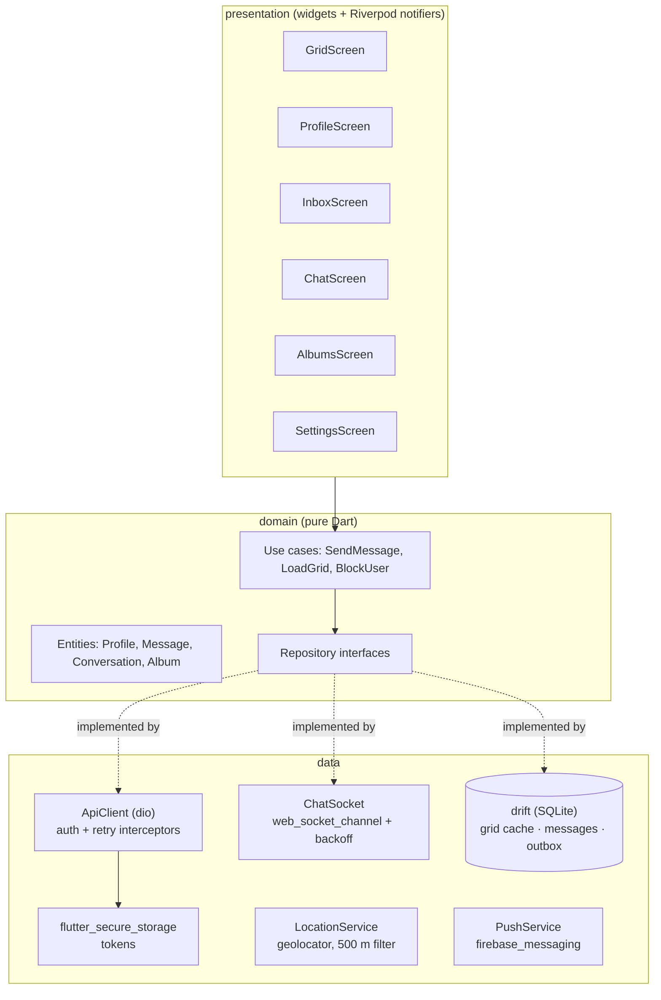

```
lib/
├── app/            # OrbitApp, router (go_router), theme, flavors
├── core/           # network (dio), storage, Failure sealed type, l10n
└── features/
    ├── onboarding/ { data, domain, presentation }
    ├── discovery/
    ├── profile/
    ├── chat/
    ├── albums/
    ├── safety/
    └── settings/
```

### 10.1 App lifecycle and battery

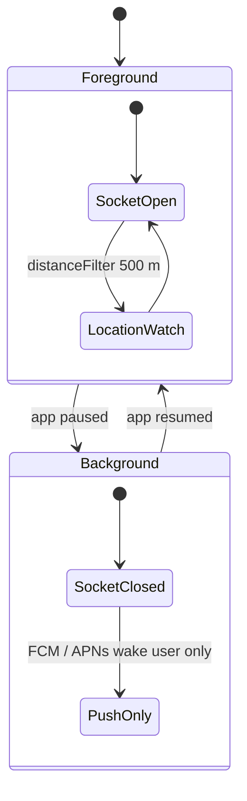

**Battery and performance checklist**

| Technique | Where |
|---|---|
| No background location, no background socket | `LocationService`, `ChatSocket` lifecycle |
| `distanceFilter: 500` with medium accuracy | `LocationService` |
| Grid thumbnails at 256 px WebP from the CDN, with `cacheWidth` set | `GridTile` |
| `GridView.builder` with `const` tiles and `ValueKey(id)` | `GridScreen` |
| First paint from the drift cache, then refresh in the background | `GridNotifier` |
| One HTTP/2 connection, gzip and brotli responses, ETags on profiles | dio + backend |
| JSON parsing for large pages off the UI thread with `compute()` | `ApiClient` |
| No ad SDKs; analytics batched and sent only in the foreground | Policy |
| Push payloads carry IDs only, so the background wake is tiny | Notification module |

---

## 11. Deployment

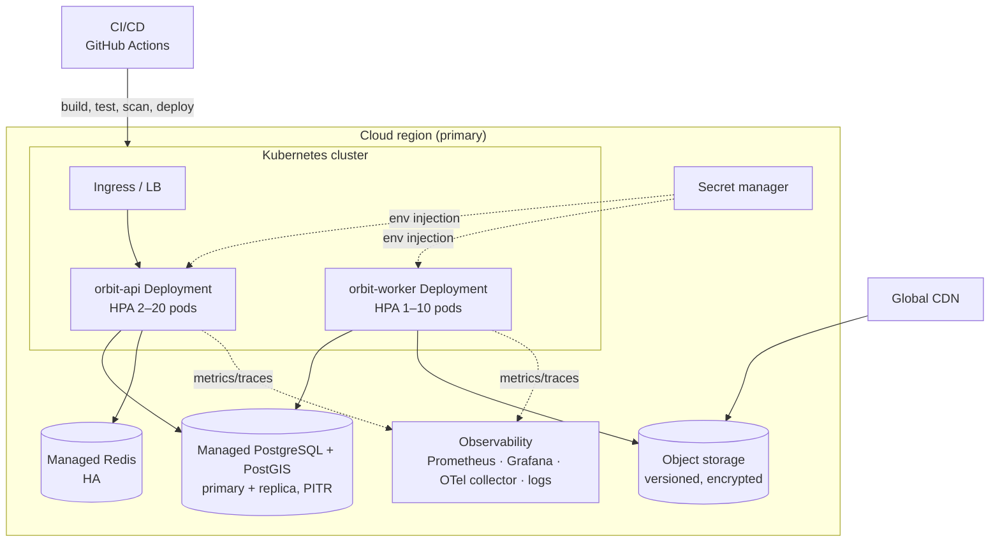

Environments are `dev`, `staging` and `prod`. Migrations run as a pre-deploy Job. Deploys are rolling and backward compatible.

---

## 12. Security and privacy

| Threat | Control |
|---|---|
| Trilateration and location tracking | ADR-0003: snapping, distance buckets, rate limits, velocity checks, hide-distance option |
| Account takeover | OIDC provider with PKCE. Short-lived access tokens (15 min). Refresh-token rotation. Tokens in Keychain or Keystore. |
| Scraping and enumeration | Profile IDs are random UUIDs. Grid access is rate-limited per account and device. Device attestation (Play Integrity, App Attest). |
| Insecure direct object references on albums and photos | Object-level checks in services (`@PreAuthorize`). Signed CDN URLs (5 min) for private media. |
| Stalking or harassment | Instant two-way blocks. Report with evidence snapshot. Moderation SLA. |
| Data breach impact | Encryption at rest. Sensitive profile fields encrypted at the column level. Minimal retention. No exact location stored. |
| Data leaking through notifications | Push carries no message text by default |
| Metadata in photos | EXIF and GPS stripped on device and again on the server |
| Illegal content | Hash matching against known CSAM databases on upload. Mandatory reporting process. |
| Underage users | Age gate. Reports of minors are routed to a priority queue. |

The app must comply with **GDPR** and **CCPA**, with a privacy-by-design review. Sexual orientation counts as **special-category data** under GDPR Article 9, which requires explicit consent and a data protection impact assessment (DPIA) before launch.

---

## 13. Observability

- **Metrics (Micrometer and Prometheus):** grid latency (p50, p95, p99), active WebSocket connections, message send-to-delivery latency, push success rate, and the moderation queue's age.
- **Tracing:** OpenTelemetry, from the app's request ID through the API, the database and the worker.
- **Logs:** JSON with trace IDs. No message text, tokens or exact coordinates are ever logged.
- **Client:** crash reporting and performance traces such as frame times and cold start, sampled and sent only in the foreground.
- **SLOs:** API availability 99.9%. Grid p95 under 150 ms. Message delivery p95 under 500 ms.

---

## 14. Testing strategy

| Layer | Tooling |
|---|---|
| Backend unit | JUnit 5 + AssertJ. Domain logic (snapping, bucketing, block rules) uses property-based tests. |
| Backend slices | `@WebMvcTest` for validation and ProblemDetail mapping. Security rules tested for unauthenticated, wrong-user and authorized requests. |
| Persistence | `@DataJpaTest` with **Testcontainers** `postgis/postgis`. KNN query plans asserted. |
| Architecture | **Spring Modulith** verification and ArchUnit layering rules |
| Chat | Two-node WebSocket integration test with Redis Testcontainer |
| Mobile | Unit (domain), widget tests with `ProviderScope` overrides, golden tests for grid tiles, `integration_test` for onboarding → grid → chat |
| Performance | k6 load tests (grid and WebSocket). Flutter DevTools frame profiling. Battery runs on reference devices. |
| Security | OWASP ZAP baseline on staging. Dependency scanning. Pen test before launch. |

---

## 15. Risks and open questions

| # | Item | Proposed resolution |
|---|---|---|
| R1 | App-store review of dating apps needs moderation, reporting and age gating | Built into v1 scope |
| R2 | Cold start, with no users in a city | Launch city by city with community partners |
| R3 | Legal exposure in countries that criminalise LGBTQ+ people | Region policy defaults, legal review, possibly no distribution in some markets |
| R4 | Cost of image moderation | Hash matching (cheap) for all images. Model inference only for public photos, plus sampling. |
| Q1 | Identity provider choice | Managed OIDC (Auth0, Cognito or Firebase Auth) or self-hosted Keycloak — to decide in ADR-0005 |
| Q2 | Final app name and trademark | Product owner |
| Q3 | Orbit+ pricing | Product owner |
