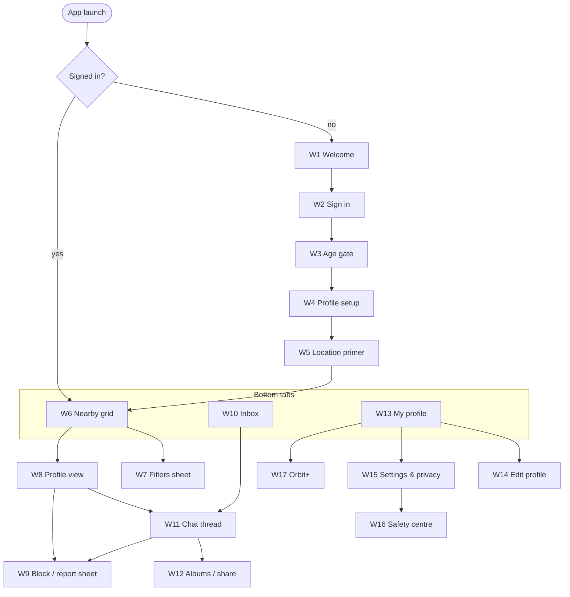

# Orbit — Wireframes (low fidelity)

These are low-fidelity layouts that define structure and behaviour, not visual style. A rendered, clickable-looking version of the same screens is published as the "Orbit Wireframes" page. Visual direction: original deep-indigo and coral palette, rounded tiles, large touch targets (48 dp minimum). It deliberately avoids any incumbent app's look.

## 0. Navigation map



---

## W1 — Welcome

```
┌─────────────────────────────┐
│                             │
│          ◯  orbit           │
│                             │
│   Meet people nearby.       │
│   Fast. Private. No ads.    │
│                             │
│   ┌───────────────────────┐ │
│   │ 🔒 Your exact location│ │
│   │    is never stored    │ │
│   └───────────────────────┘ │
│                             │
│ ┌─────────────────────────┐ │
│ │       Get started       │ │
│ └─────────────────────────┘ │
│   I already have an account │
│  Terms · Privacy · 18+ only │
└─────────────────────────────┘
```

## W2 — Sign in

```
┌─────────────────────────────┐
│ ←                           │
│  Sign in to Orbit           │
│                             │
│ ┌─────────────────────────┐ │
│ │   Continue with Apple   │ │
│ └─────────────────────────┘ │
│ ┌─────────────────────────┐ │
│ │  Continue with Google   │ │
│ └─────────────────────────┘ │
│ ┌─────────────────────────┐ │
│ │ Continue with phone (OTP)│ │
│ └─────────────────────────┘ │
│                             │
│  We never post anything     │
│  or show Orbit on your      │
│  other accounts.            │
└─────────────────────────────┘
```

## W3 — Age gate

```
┌─────────────────────────────┐
│ ←                  Step 1/3 │
│  When's your birthday?      │
│                             │
│   ┌────┐ ┌────┐ ┌──────┐    │
│   │ DD │ │ MM │ │ YYYY │    │
│   └────┘ └────┘ └──────┘    │
│                             │
│  You must be 18+. Your      │
│  birthday is private; only  │
│  your age can be shown.     │
│                             │
│ ┌─────────────────────────┐ │
│ │        Continue         │ │
│ └─────────────────────────┘ │
└─────────────────────────────┘
```

## W4 — Profile setup

```
┌─────────────────────────────┐
│ ←                  Step 2/3 │
│  Make your profile          │
│   ┌───────┐                 │
│   │  ＋   │ Add a photo      │
│   │ photo │ (optional, can  │
│   └───────┘  skip for now)  │
│  Display name               │
│  ┌───────────────────────┐  │
│  │                       │  │
│  └───────────────────────┘  │
│  Looking for (pick any)     │
│  [Chat] [Dates] [Friends]   │
│  [Networking] [Right now]   │
│ ┌─────────────────────────┐ │
│ │        Continue         │ │
│ └─────────────────────────┘ │
└─────────────────────────────┘
```

## W5 — Location primer (shown before the OS prompt)

```
┌─────────────────────────────┐
│                    Step 3/3 │
│          📍                 │
│  See who's nearby           │
│                             │
│  ✓ Only while using the app │
│  ✓ Rounded to your area —   │
│    never your exact spot    │
│  ✓ Hide your distance any   │
│    time in Settings         │
│                             │
│ ┌─────────────────────────┐ │
│ │    Allow while using    │ │
│ └─────────────────────────┘ │
│        Not now              │
└─────────────────────────────┘
```

## W6 — Nearby grid (home)

```
┌─────────────────────────────┐
│ orbit     [Online ▾]  ⚙︎ ⧩  │  ⧩ = filters
├─────────────────────────────┤
│ Fresh faces ▸ ◯ ◯ ◯ ◯ ◯ ◯   │  horizontal strip
├─────────┬─────────┬─────────┤
│ ▓▓▓▓▓▓▓ │ ▓▓▓▓▓▓▓ │ ▓▓▓▓▓▓▓ │
│ ▓▓▓▓▓▓▓ │ ▓▓▓▓▓▓▓ │ ▓▓▓▓▓▓▓ │
│●Alex 27 │ Sam 31  │●Jo 24   │  ● online
│ <1 km   │ 1 km    │ 2 km    │  bucketed distance
├─────────┼─────────┼─────────┤
│ ▓▓▓▓▓▓▓ │ ▓▓▓▓▓▓▓ │ ▓▓▓▓▓▓▓ │
│ ▓▓▓▓▓▓▓ │ ▓▓▓▓▓▓▓ │ ▓▓▓▓▓▓▓ │
│ Kai 29  │●Ren 35  │ —  —    │  "—" distance hidden
│ 3 km    │ 3 km    │         │
├─────────┴─────────┴─────────┤
│   ⊞ Nearby   💬 Inbox(3)  ◯ Me │
└─────────────────────────────┘
```
Behaviour: pull to refresh; infinite scroll in pages of 60; the first paint comes from the cache. Long-press a tile for the quick actions favorite, wave and block.

## W7 — Filters (bottom sheet)

```
┌─────────────────────────────┐
│ ─────                       │
│ Filters            Reset    │
│ Age        [18] ━━●━━━● [45]│
│ Online now           [ ●]   │
│ Has photo            [ ●]   │
│ Looking for                 │
│  [Chat✓] [Dates] [Friends]  │
│ Tags                        │
│  [+ add tag]                │
│ ── Orbit+ ───────────────── │
│ Height · Body · Position 🔒 │
│ ┌─────────────────────────┐ │
│ │      Show 124 people     │ │
│ └─────────────────────────┘ │
└─────────────────────────────┘
```

## W8 — Profile view

```
┌─────────────────────────────┐
│ ←                   ☆  ⋯    │  ⋯ = block/report
│ ┌─────────────────────────┐ │
│ │                         │ │
│ │       photo 1 / 4       │ │  swipe for more
│ │                         │ │
│ └─────────────────────────┘ │
│ ● Alex, 27      <1 km       │
│ he/him · 180 cm             │
│ "Coffee, climbing, bad      │
│  puns."                     │
│ Looking for: Chat · Dates   │
│ #hiking #music #foodie      │
│                             │
│ ┌───────┐ ┌───────────────┐ │
│ │ 👋Wave│ │   💬 Message   │ │
│ └───────┘ └───────────────┘ │
└─────────────────────────────┘
```

## W9 — Block / report sheet

```
┌─────────────────────────────┐
│ ─────                       │
│ Alex                        │
│ ┌─────────────────────────┐ │
│ │ ⛔ Block                 │ │  1 tap → confirm
│ └─────────────────────────┘ │
│ ┌─────────────────────────┐ │
│ │ ⚑ Report                │ │
│ └─────────────────────────┘ │
│  Report reason:             │
│  ○ Fake / spam              │
│  ○ Harassment               │
│  ○ Underage                 │
│  ○ Inappropriate photos     │
│  ○ Threat / danger          │
│  [✓] Also block             │
│ ┌─────────────────────────┐ │
│ │         Submit          │ │
│ └─────────────────────────┘ │
└─────────────────────────────┘
```

## W10 — Inbox

```
┌─────────────────────────────┐
│ Inbox     [All|Unread|Favs] │
├─────────────────────────────┤
│ ◯● Alex          2m    (2)  │
│    Sounds good! 🙂          │
├─────────────────────────────┤
│ ◯  Sam           1h         │
│    📷 Photo                 │
├─────────────────────────────┤
│ ◯  Jo            Tue        │
│    👋 Waved at you          │
├─────────────────────────────┤
│  Swipe ← : mute · delete    │
├─────────────────────────────┤
│   ⊞ Nearby   💬 Inbox   ◯ Me │
└─────────────────────────────┘
```

## W11 — Chat thread

```
┌─────────────────────────────┐
│ ← ◯● Alex · online      ⋯   │
├─────────────────────────────┤
│              Hey! 👋     ✓✓ │  ✓✓ read (if enabled)
│ ┌──────────────────┐        │
│ │ Hi! How's it     │        │
│ │ going?           │        │
│ └──────────────────┘        │
│        ┌────────────────┐   │
│        │ 📍 Live loc 30m │  │  timed share
│        └────────────────┘   │
│ Alex is typing…             │
├─────────────────────────────┤
│ [＋] [📷] [🗂 Album] [📍]   │
│ ┌───────────────────┐ ┌───┐ │
│ │ Message…          │ │ ➤ │ │
│ └───────────────────┘ └───┘ │
└─────────────────────────────┘
```

## W12 — Albums / share album

```
┌─────────────────────────────┐
│ ← Share an album with Alex  │
├─────────────────────────────┤
│ ┌─────────┐ ┌─────────┐     │
│ │ ▓▓▓▓▓▓▓ │ │ ▓▓▓▓▓▓▓ │     │
│ │ Travel  │ │ Private │     │
│ │ 12 pics │ │ 5 pics🔒│     │
│ └─────────┘ └─────────┘     │
│ Access:  (●) 24 h  ( ) 7 d  │
│          ( ) Until revoked  │
│ [ ] View-once photos        │
│ ┌─────────────────────────┐ │
│ │          Share          │ │
│ └─────────────────────────┘ │
│ Shared with: Sam (revoke)   │
└─────────────────────────────┘
```

## W13 — Me (own profile hub)

```
┌─────────────────────────────┐
│ Me                      ⚙︎   │
│      ┌───────┐              │
│      │ photo │  You, 30     │
│      └───────┘  Profile 80% │
│ ┌─────────────────────────┐ │
│ │ ✎ Edit profile          │ │
│ │ 🗂 My albums            │ │
│ │ ☆ Favorites             │ │
│ │ ✨ Orbit+               │ │
│ │ 🛡 Safety centre        │ │
│ │ ⚙︎ Settings & privacy    │ │
│ └─────────────────────────┘ │
├─────────────────────────────┤
│   ⊞ Nearby   💬 Inbox   ◯ Me │
└─────────────────────────────┘
```

## W14 — Edit profile

```
┌─────────────────────────────┐
│ ←  Edit profile       Save  │
│ Photos (drag to reorder)    │
│ [▓▓][▓▓][▓▓][＋][＋][＋]      │
│  ⏳ 1 photo in review        │
│ Display name  [Alex       ] │
│ About me      [           ] │
│ Pronouns      [he/him   ▾] │
│ Height        [180 cm   ▾] │
│ Looking for   [Chat, Dates] │
│ Tags          [+ add]       │
│ ── Show on profile ──────── │
│ Age           [ ●]          │
│ Distance      [ ●]          │
└─────────────────────────────┘
```

## W15 — Settings & privacy

```
┌─────────────────────────────┐
│ ←  Settings & privacy       │
│ PRIVACY                     │
│ Show distance        [ ●]   │
│ Read receipts        [ ●]   │
│ Message previews in push [ ]│
│ Incognito (Orbit+)   [  ]🔒 │
│ SECURITY                    │
│ Discreet app icon     ›     │
│ Shake to hide         [ ●]  │
│ App lock (Face ID)    [  ]  │
│ NOTIFICATIONS          ›    │
│ YOUR DATA                   │
│ Export my data        ›     │
│ Delete account        ›     │
│ Blocked users         ›     │
└─────────────────────────────┘
```

## W16 — Safety centre

```
┌─────────────────────────────┐
│ ←  Safety centre            │
│ ┌─────────────────────────┐ │
│ │ 🧭 Meeting someone new  │ │
│ │ Tips + share live loc   │ │
│ │ with a trusted friend   │ │
│ └─────────────────────────┘ │
│ ┌─────────────────────────┐ │
│ │ 🌍 Travel safety        │ │
│ │ Region-aware defaults   │ │
│ └─────────────────────────┘ │
│ ┌─────────────────────────┐ │
│ │ 🩺 Sexual health        │ │
│ │ Testing reminders, links│ │
│ └─────────────────────────┘ │
│ ┌─────────────────────────┐ │
│ │ ☎︎  Get help now         │ │
│ └─────────────────────────┘ │
└─────────────────────────────┘
```

## W17 — Orbit+

```
┌─────────────────────────────┐
│ ×                           │
│         ✨ Orbit+            │
│  Always ad-free. Plus:      │
│  ✓ 600 profiles in grid     │
│  ✓ Advanced filters         │
│  ✓ Incognito browsing       │
│  ✓ See who viewed you       │
│  ✓ Unlimited favorites      │
│  Safety tools are free for  │
│  everyone, always.          │
│ ┌───────────┐ ┌───────────┐ │
│ │ 1 month   │ │ 12 months │ │
│ │   $X.XX   │ │ $Y.YY -40%│ │
│ └───────────┘ └───────────┘ │
│ ┌─────────────────────────┐ │
│ │       Subscribe         │ │
│ └─────────────────────────┘ │
│  Restore purchases · Terms  │
└─────────────────────────────┘
```

---

## Interaction states to design (hi-fi phase)

| Screen | Empty | Loading | Error | Offline |
|---|---|---|---|---|
| Grid | "No one nearby yet — widen filters" | Shimmer tiles | Retry banner | Cached grid + "Offline" pill |
| Inbox | "Say hi to someone nearby" | Skeleton rows | Retry | Cached + queued sends |
| Chat | Starter quick phrases | — | Failed bubble + retry | Pending clock icon |
| Profile | — | Blur-up photo | "Profile unavailable" (also shown when blocked) | Cached if seen |
