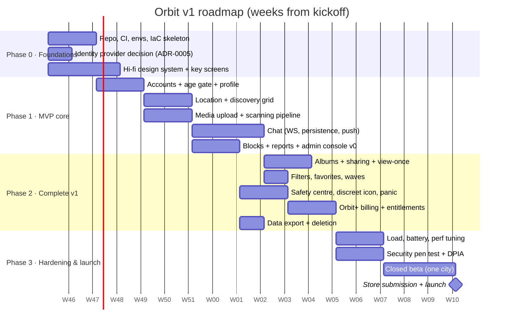

# Orbit — Delivery Plan

Status: Draft v0.1 · 2026-11-09. This plan assumes a small team: 2 backend, 2 Flutter, 1 design, with QA shared. Dates are relative to a kickoff, week 0.

## Phases



## Milestones and exit criteria

| Milestone | Exit criteria |
|---|---|
| **M0 Foundations** | CI green on an empty Spring Boot and Flutter skeleton. Staging environment up. Design system ready in Figma. ADR-0005 accepted. |
| **M1 MVP core** | A tester can sign up, set up a profile, see a real grid, chat with another tester in real time, and block and report. Grid p95 under 150 ms in staging with 100k seeded users. |
| **M2 Feature-complete v1** | Every feature in design doc §2 works end to end on both platforms. |
| **M3 Launch-ready** | Performance and battery targets in design doc §1 met on reference devices. Pen test findings fixed. DPIA signed off. Beta crash-free rate of at least 99.5%. |

## First sprint backlog (Phase 0 → Phase 1 start)

1. `chore:` monorepo layout: `backend/` (Gradle wrapper, Spring Boot, Spring Modulith), `mobile/` (Flutter with dev, staging and prod flavors), `infra/`, `docs/`.
2. `chore:` CI pipeline: Spotless, Checkstyle, Error Prone, tests with Testcontainers (PostGIS, Redis), `dart format`, `very_good_analysis`, `flutter test`, and OWASP dependency scanning.
3. `feat(identity):` OIDC resource server config, `POST /api/v1/accounts` with age gate, ProblemDetail error handler.
4. `feat(profile):` profile entity, Flyway V1 migration, `GET/PUT /me/profile`.
5. `feat(mobile):` app shell with go_router, theme tokens, onboarding screens W1–W5 with mocked API.
6. `test:` ArchUnit and Modulith boundary tests from day one.

## Proposed repository layout

```
orbit/
├── backend/            # Spring Boot modular monolith (orbit-api + orbit-worker profiles)
├── mobile/             # Flutter app
├── admin/              # Moderator console (later; Next.js or Spring + server-rendered pages)
├── infra/              # Terraform / Helm
└── docs/
    ├── adr/
    ├── design/
    └── plan.md
```

## Decisions needed from the product owner

1. The final app name. "Orbit" is a placeholder.
2. Managed identity provider or self-hosted Keycloak (ADR-0005).
3. Orbit+ price points and which features are paid.
4. The beta launch city.
